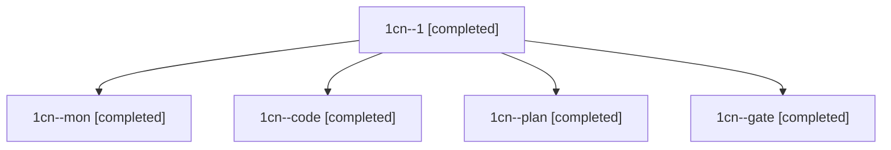

# Session: 1cn

[Agent Hoods](../README.md) / [bbugyi200](../users/bbugyi200/README.md) / [athena](../users/bbugyi200/machines/athena/README.md) / [1cn](../users/bbugyi200/machines/athena/hoods/1cn/README.md) / 1cn

Owner: `bbugyi200.athena` · Hood: `1cn` · Members: 5

## Lineage

The diagram is an optional enhancement; the ordered table below contains the same lineage in accessible text.

| Role | Agent | State | Model / provider | Timing | Commits | Prompt | Chat |
|---|---|---|---|---|---:|---|---|
| 1 | 1cn--1 | completed | muse-spark-1.3-contributor / muse | 2026-11-15T18:42:34.673372+00:00 → 2026-11-15T18:45:42.783996+00:00 | [1](../agents/bbugyi200.athena.1cn--1/README.md#commits) | [Prompt](../agents/bbugyi200.athena.1cn--1/prompt.md) | [Chat](../agents/bbugyi200.athena.1cn--1/chat.md) |
| mon | 1cn--mon | completed | muse-spark-1.3-contributor / muse | 2026-11-15T18:31:47.264475+00:00 → 2026-11-15T18:41:47.471166+00:00 | 0 | — | [Chat](../agents/bbugyi200.athena.1cn--mon/chat.md) |
| code | 1cn--code | completed | muse-spark-1.3-contributor / muse | 2026-11-15T18:06:24.993616+00:00 → 2026-11-15T18:33:33.697520+00:00 | 0 | [Prompt](../agents/bbugyi200.athena.1cn--code/prompt.md) | [Chat](../agents/bbugyi200.athena.1cn--code/chat.md) |
| plan | 1cn--plan | completed | opus / claude | 2026-11-15T17:47:13.664735+00:00 → 2026-11-15T18:01:58.997207+00:00 | 0 | [Prompt](../agents/bbugyi200.athena.1cn--plan/prompt.md) | [Chat](../agents/bbugyi200.athena.1cn--plan/chat.md) |
| gate | 1cn--gate | completed | opus / claude | 2026-11-15T18:04:23.282101+00:00 → 2026-11-15T18:05:49.025392+00:00 | 0 | — | [Chat](../agents/bbugyi200.athena.1cn--gate/chat.md) |

## Commits

| Role | Repo | Commit | Subject | Committed |
|---|---|---|---|---|
| 1 | sase | [`3ee3f17`](https://github.com/sase-org/sase/commit/3ee3f17ab44065517d622e02241b8229b7fc4d72) | fix(agents): eliminate phantom starting claim rows on incomplete merge | 2026-11-15 13:45:20 EST |
