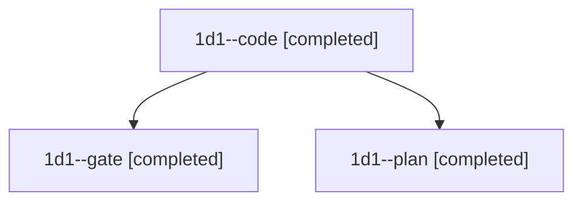

# Session: 1d1

[Agent Hoods](../README.md) / [bbugyi200](../users/bbugyi200/README.md) / [athena](../users/bbugyi200/machines/athena/README.md) / [1d1](../users/bbugyi200/machines/athena/hoods/1d1/README.md) / 1d1

Owner: `bbugyi200.athena` · Hood: `1d1` · Members: 3

## Lineage

The diagram is an optional enhancement; the ordered table below contains the same lineage in accessible text.

| Role | Agent | State | Model / provider | Timing | Commits | Prompt | Chat |
|---|---|---|---|---|---:|---|---|
| code | 1d1--code | completed | muse-spark-1.3-contributor / muse | 2026-11-16T19:20:08.821759+00:00 → 2026-11-16T19:31:44.386648+00:00 | [1](../agents/bbugyi200.athena.1d1--code/README.md#commits) | [Prompt](../agents/bbugyi200.athena.1d1--code/prompt.md) | [Chat](../agents/bbugyi200.athena.1d1--code/chat.md) |
| gate | 1d1--gate | completed | opus / claude | 2026-11-16T19:18:09.899559+00:00 → 2026-11-16T19:19:24.864793+00:00 | 0 | — | [Chat](../agents/bbugyi200.athena.1d1--gate/chat.md) |
| plan | 1d1--plan | completed | opus / claude | 2026-11-16T19:11:58.432451+00:00 → 2026-11-16T19:17:43.120861+00:00 | 0 | [Prompt](../agents/bbugyi200.athena.1d1--plan/prompt.md) | [Chat](../agents/bbugyi200.athena.1d1--plan/chat.md) |

## Commits

| Role | Repo | Commit | Subject | Committed |
|---|---|---|---|---|
| code | sase | [`a79f27e`](https://github.com/sase-org/sase/commit/a79f27e1dd5a84f23cafb3e568531b820ec93008) | fix(gates): stop gate commands inheriting the gate.answer proc sidecar | 2026-11-16 14:31:16 EST |
