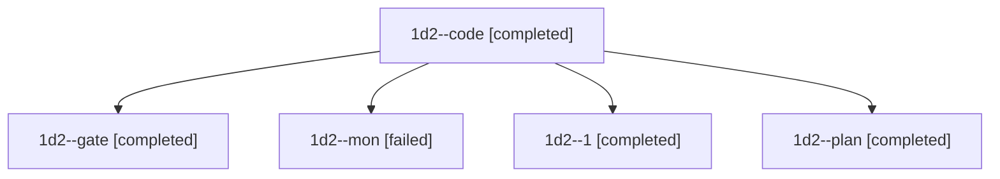

# Session: 1d2

[Agent Hoods](../README.md) / [bbugyi200](../users/bbugyi200/README.md) / [athena](../users/bbugyi200/machines/athena/README.md) / [1d2](../users/bbugyi200/machines/athena/hoods/1d2/README.md) / 1d2

Owner: `bbugyi200.athena` · Hood: `1d2` · Members: 5

## Lineage

The diagram is an optional enhancement; the ordered table below contains the same lineage in accessible text.

| Role | Agent | State | Model / provider | Timing | Commits | Prompt | Chat |
|---|---|---|---|---|---:|---|---|
| code | 1d2--code | completed | muse-spark-1.3-contributor / muse | 2026-11-16T20:42:00.025489+00:00 → 2026-11-16T21:10:54.400882+00:00 | 0 | [Prompt](../agents/bbugyi200.athena.1d2--code/prompt.md) | [Chat](../agents/bbugyi200.athena.1d2--code/chat.md) |
| gate | 1d2--gate | completed | opus / claude | 2026-11-16T20:40:57.720599+00:00 → 2026-11-16T20:41:36.351546+00:00 | 0 | — | [Chat](../agents/bbugyi200.athena.1d2--gate/chat.md) |
| mon | 1d2--mon | failed | muse-spark-1.3-contributor / muse | 2026-11-16T21:09:30.159423+00:00 → 2026-11-16T21:49:31.044487+00:00 | 0 | — | [Chat](../agents/bbugyi200.athena.1d2--mon/chat.md) |
| 1 | 1d2--1 | completed | muse-spark-1.3-contributor / muse | 2026-11-16T21:51:18.368414+00:00 → 2026-11-16T22:07:29.178872+00:00 | [1](../agents/bbugyi200.athena.1d2--1/README.md#commits) | [Prompt](../agents/bbugyi200.athena.1d2--1/prompt.md) | [Chat](../agents/bbugyi200.athena.1d2--1/chat.md) |
| plan | 1d2--plan | completed | opus / claude | 2026-11-16T19:36:05.005880+00:00 → 2026-11-16T19:50:23.218990+00:00 | 0 | [Prompt](../agents/bbugyi200.athena.1d2--plan/prompt.md) | [Chat](../agents/bbugyi200.athena.1d2--plan/chat.md) |

## Commits

| Role | Repo | Commit | Subject | Committed |
|---|---|---|---|---|
| 1 | sase | [`3a2b268`](https://github.com/sase-org/sase/commit/3a2b26855d32e05b08fecb5dd2a6a37d238951de) | fix(workspace): align eviction tests with unborn HEAD preservation error | 2026-11-16 17:07:16 EST |
