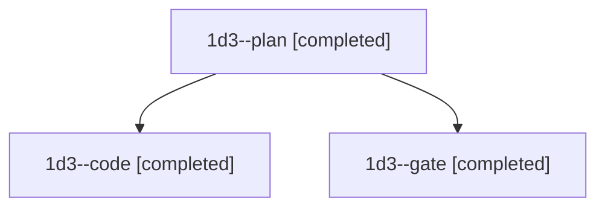

# Session: 1d3

[Agent Hoods](../README.md) / [bbugyi200](../users/bbugyi200/README.md) / [athena](../users/bbugyi200/machines/athena/README.md) / [1d3](../users/bbugyi200/machines/athena/hoods/1d3/README.md) / 1d3

Owner: `bbugyi200.athena` · Hood: `1d3` · Members: 3

## Lineage

The diagram is an optional enhancement; the ordered table below contains the same lineage in accessible text.

| Role | Agent | State | Model / provider | Timing | Commits | Prompt | Chat |
|---|---|---|---|---|---:|---|---|
| plan | 1d3--plan | completed | opus / claude | 2026-11-16T20:53:57.676624+00:00 → 2026-11-16T21:00:37.311026+00:00 | 0 | [Prompt](../agents/bbugyi200.athena.1d3--plan/prompt.md) | [Chat](../agents/bbugyi200.athena.1d3--plan/chat.md) |
| code | 1d3--code | completed | gpt-6-luna / codex | 2026-11-16T21:03:01.311347+00:00 → 2026-11-16T21:33:45.494133+00:00 | [1](../agents/bbugyi200.athena.1d3--code/README.md#commits) | [Prompt](../agents/bbugyi200.athena.1d3--code/prompt.md) | [Chat](../agents/bbugyi200.athena.1d3--code/chat.md) |
| gate | 1d3--gate | completed | opus / claude | 2026-11-16T21:01:46.148779+00:00 → 2026-11-16T21:02:38.298097+00:00 | 0 | — | [Chat](../agents/bbugyi200.athena.1d3--gate/chat.md) |

## Commits

| Role | Repo | Commit | Subject | Committed |
|---|---|---|---|---|
| code | sase | [`ab352ae`](https://github.com/sase-org/sase/commit/ab352aeeb66dc115dbe61ddf7ddd9c87a968b011) | fix(ace): guard eager annotation evaluation on Python 3.12 | 2026-11-16 16:33:29 EST |
