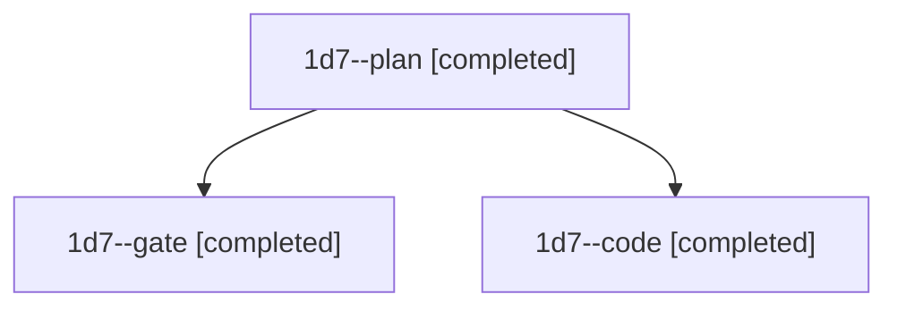

# Session: 1d7

[Agent Hoods](../README.md) / [bbugyi200](../users/bbugyi200/README.md) / [athena](../users/bbugyi200/machines/athena/README.md) / [1d7](../users/bbugyi200/machines/athena/hoods/1d7/README.md) / 1d7

Owner: `bbugyi200.athena` · Hood: `1d7` · Members: 3

## Lineage

The diagram is an optional enhancement; the ordered table below contains the same lineage in accessible text.

| Role | Agent | State | Model / provider | Timing | Commits | Prompt | Chat |
|---|---|---|---|---|---:|---|---|
| plan | 1d7--plan | completed | opus / claude | 2026-11-17T11:05:36.627866+00:00 → 2026-11-17T11:19:30.344531+00:00 | 0 | [Prompt](../agents/bbugyi200.athena.1d7--plan/prompt.md) | [Chat](../agents/bbugyi200.athena.1d7--plan/chat.md) |
| gate | 1d7--gate | completed | opus / claude | 2026-11-17T11:20:34.598297+00:00 → 2026-11-17T11:21:29.379304+00:00 | 0 | — | [Chat](../agents/bbugyi200.athena.1d7--gate/chat.md) |
| code | 1d7--code | completed | muse-spark-1.3-contributor / muse | 2026-11-17T11:21:51.615302+00:00 → 2026-11-17T11:43:12.997410+00:00 | [1](../agents/bbugyi200.athena.1d7--code/README.md#commits) | [Prompt](../agents/bbugyi200.athena.1d7--code/prompt.md) | [Chat](../agents/bbugyi200.athena.1d7--code/chat.md) |

## Commits

| Role | Repo | Commit | Subject | Committed |
|---|---|---|---|---|
| code | sase | [`25849b5`](https://github.com/sase-org/sase/commit/25849b582c21ab593eec6fdc88dc888e4261d3a9) | feat(gates): publish starter continuation node on gate handoffs | 2026-11-17 06:42:59 EST |
