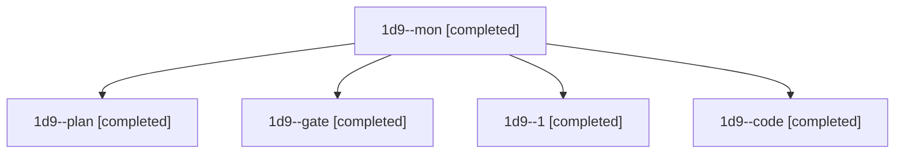

# Session: 1d9

[Agent Hoods](../README.md) / [bbugyi200](../users/bbugyi200/README.md) / [athena](../users/bbugyi200/machines/athena/README.md) / [1d9](../users/bbugyi200/machines/athena/hoods/1d9/README.md) / 1d9

Owner: `bbugyi200.athena` · Hood: `1d9` · Members: 5

## Lineage

The diagram is an optional enhancement; the ordered table below contains the same lineage in accessible text.

| Role | Agent | State | Model / provider | Timing | Commits | Prompt | Chat |
|---|---|---|---|---|---:|---|---|
| mon | 1d9--mon | completed | muse-spark-1.3-contributor / muse | 2026-11-17T12:16:23.861883+00:00 → 2026-11-17T12:32:58.517656+00:00 | 0 | — | [Chat](../agents/bbugyi200.athena.1d9--mon/chat.md) |
| plan | 1d9--plan | completed | opus / claude | 2026-11-17T11:47:18.062662+00:00 → 2026-11-17T11:52:33.143653+00:00 | 0 | [Prompt](../agents/bbugyi200.athena.1d9--plan/prompt.md) | [Chat](../agents/bbugyi200.athena.1d9--plan/chat.md) |
| gate | 1d9--gate | completed | opus / claude | 2026-11-17T11:53:07.720917+00:00 → 2026-11-17T11:53:56.425515+00:00 | 0 | — | [Chat](../agents/bbugyi200.athena.1d9--gate/chat.md) |
| 1 | 1d9--1 | completed | muse-spark-1.3-contributor / muse | 2026-11-17T12:32:58.105664+00:00 → 2026-11-17T12:35:19.578927+00:00 | [1](../agents/bbugyi200.athena.1d9--1/README.md#commits) | [Prompt](../agents/bbugyi200.athena.1d9--1/prompt.md) | [Chat](../agents/bbugyi200.athena.1d9--1/chat.md) |
| code | 1d9--code | completed | muse-spark-1.3-contributor / muse | 2026-11-17T11:54:19.435478+00:00 → 2026-11-17T12:18:14.678118+00:00 | 0 | [Prompt](../agents/bbugyi200.athena.1d9--code/prompt.md) | [Chat](../agents/bbugyi200.athena.1d9--code/chat.md) |

## Commits

| Role | Repo | Commit | Subject | Committed |
|---|---|---|---|---|
| 1 | sase | [`b0de764`](https://github.com/sase-org/sase/commit/b0de76422dc1811c6eeb177a01a0fe7085c58ffd) | fix(axe): silence unmanaged-project noise in retention and publication | 2026-11-17 07:35:05 EST |
