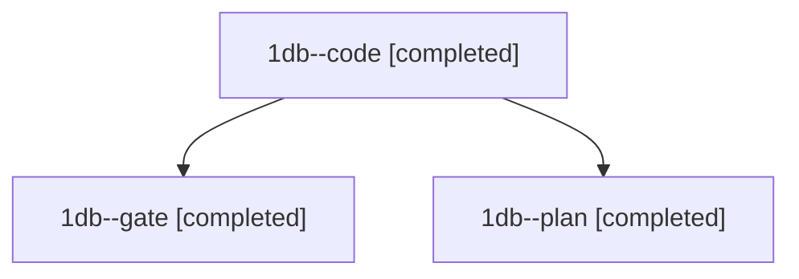

# Session: 1db

[Agent Hoods](../README.md) / [bbugyi200](../users/bbugyi200/README.md) / [athena](../users/bbugyi200/machines/athena/README.md) / [1db](../users/bbugyi200/machines/athena/hoods/1db/README.md) / 1db

Owner: `bbugyi200.athena` · Hood: `1db` · Members: 3

## Lineage

The diagram is an optional enhancement; the ordered table below contains the same lineage in accessible text.

| Role | Agent | State | Model / provider | Timing | Commits | Prompt | Chat |
|---|---|---|---|---|---:|---|---|
| code | 1db--code | completed | muse-spark-1.3-contributor / muse | 2026-11-17T12:25:13.597353+00:00 → 2026-11-17T13:11:09.764772+00:00 | [1](../agents/bbugyi200.athena.1db--code/README.md#commits) | [Prompt](../agents/bbugyi200.athena.1db--code/prompt.md) | [Chat](../agents/bbugyi200.athena.1db--code/chat.md) |
| gate | 1db--gate | completed | opus / claude | 2026-11-17T12:23:13.214096+00:00 → 2026-11-17T12:24:18.136107+00:00 | 0 | — | [Chat](../agents/bbugyi200.athena.1db--gate/chat.md) |
| plan | 1db--plan | completed | opus / claude | 2026-11-17T12:18:16.209683+00:00 → 2026-11-17T12:22:52.791644+00:00 | 0 | [Prompt](../agents/bbugyi200.athena.1db--plan/prompt.md) | [Chat](../agents/bbugyi200.athena.1db--plan/chat.md) |

## Commits

| Role | Repo | Commit | Subject | Committed |
|---|---|---|---|---|
| code | sase | [`ea7916d`](https://github.com/sase-org/sase/commit/ea7916d7a7084abc0d1fe2ffe9a5f8f729295f18) | feat(axe): record script-vanished-during-code-swap as skipped retryable run | 2026-11-17 08:10:56 EST |
