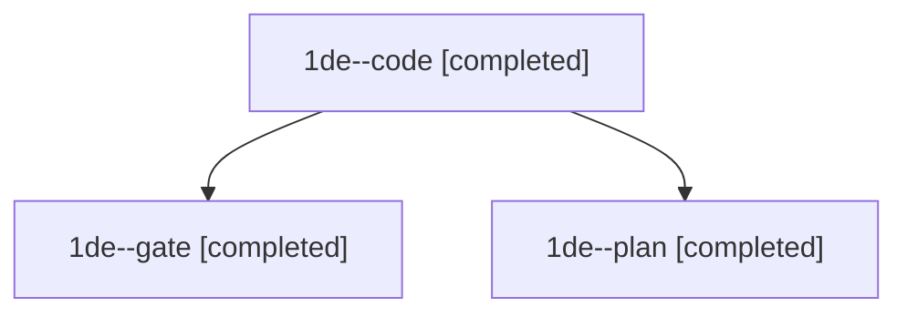

# Session: 1de

[Agent Hoods](../README.md) / [bbugyi200](../users/bbugyi200/README.md) / [athena](../users/bbugyi200/machines/athena/README.md) / [1de](../users/bbugyi200/machines/athena/hoods/1de/README.md) / 1de

Owner: `bbugyi200.athena` · Hood: `1de` · Members: 3

## Lineage

The diagram is an optional enhancement; the ordered table below contains the same lineage in accessible text.

| Role | Agent | State | Model / provider | Timing | Commits | Prompt | Chat |
|---|---|---|---|---|---:|---|---|
| code | 1de--code | completed | muse-spark-1.3-contributor / muse | 2026-11-17T15:10:49.687747+00:00 → 2026-11-17T15:32:26.287471+00:00 | [1](../agents/bbugyi200.athena.1de--code/README.md#commits) | [Prompt](../agents/bbugyi200.athena.1de--code/prompt.md) | [Chat](../agents/bbugyi200.athena.1de--code/chat.md) |
| gate | 1de--gate | completed | opus / claude | 2026-11-17T15:09:38.748536+00:00 → 2026-11-17T15:10:28.032009+00:00 | 0 | — | [Chat](../agents/bbugyi200.athena.1de--gate/chat.md) |
| plan | 1de--plan | completed | opus / claude | 2026-11-17T15:04:24.457817+00:00 → 2026-11-17T15:09:16.755983+00:00 | 0 | [Prompt](../agents/bbugyi200.athena.1de--plan/prompt.md) | [Chat](../agents/bbugyi200.athena.1de--plan/chat.md) |

## Commits

| Role | Repo | Commit | Subject | Committed |
|---|---|---|---|---|
| code | sase | [`15aa60a`](https://github.com/sase-org/sase/commit/15aa60a07e7a5892a8a6caa23e1adb3f70e255e5) | feat(updates): scope update-status snapshot to the running install | 2026-11-17 10:32:12 EST |
