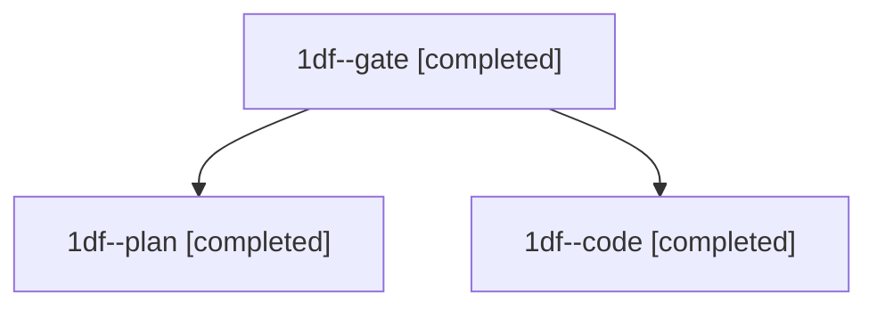

# Session: 1df

[Agent Hoods](../README.md) / [bbugyi200](../users/bbugyi200/README.md) / [athena](../users/bbugyi200/machines/athena/README.md) / [1df](../users/bbugyi200/machines/athena/hoods/1df/README.md) / 1df

Owner: `bbugyi200.athena` · Hood: `1df` · Members: 3

## Lineage

The diagram is an optional enhancement; the ordered table below contains the same lineage in accessible text.

| Role | Agent | State | Model / provider | Timing | Commits | Prompt | Chat |
|---|---|---|---|---|---:|---|---|
| gate | 1df--gate | completed | opus / claude | 2026-11-17T15:19:52.533216+00:00 → 2026-11-17T15:20:44.943259+00:00 | 0 | — | [Chat](../agents/bbugyi200.athena.1df--gate/chat.md) |
| plan | 1df--plan | completed | opus / claude | 2026-11-17T15:08:59.501529+00:00 → 2026-11-17T15:17:12.225724+00:00 | 0 | [Prompt](../agents/bbugyi200.athena.1df--plan/prompt.md) | [Chat](../agents/bbugyi200.athena.1df--plan/chat.md) |
| code | 1df--code | completed | grok-4.6 / grok | 2026-11-17T15:21:07.452375+00:00 → 2026-11-17T15:42:00.408770+00:00 | [1](../agents/bbugyi200.athena.1df--code/README.md#commits) | [Prompt](../agents/bbugyi200.athena.1df--code/prompt.md) | [Chat](../agents/bbugyi200.athena.1df--code/chat.md) |

## Commits

| Role | Repo | Commit | Subject | Committed |
|---|---|---|---|---|
| code | sase | [`df06821`](https://github.com/sase-org/sase/commit/df06821acc1c62fedf1e9d65fa7fd0627d175759) | feat(tui): enlarge the K bead preview card | 2026-11-17 10:41:34 EST |
