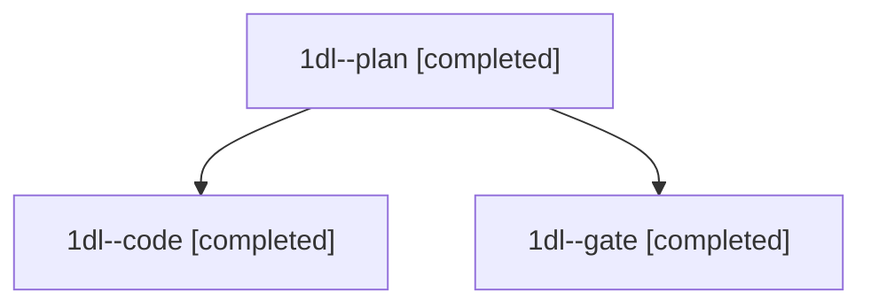

# Session: 1dl

[Agent Hoods](../README.md) / [bbugyi200](../users/bbugyi200/README.md) / [athena](../users/bbugyi200/machines/athena/README.md) / [1dl](../users/bbugyi200/machines/athena/hoods/1dl/README.md) / 1dl

Owner: `bbugyi200.athena` · Hood: `1dl` · Members: 3

## Lineage

The diagram is an optional enhancement; the ordered table below contains the same lineage in accessible text.

| Role | Agent | State | Model / provider | Timing | Commits | Prompt | Chat |
|---|---|---|---|---|---:|---|---|
| plan | 1dl--plan | completed | opus / claude | 2026-11-17T17:42:24.055807+00:00 → 2026-11-17T17:50:01.895750+00:00 | 0 | [Prompt](../agents/bbugyi200.athena.1dl--plan/prompt.md) | [Chat](../agents/bbugyi200.athena.1dl--plan/chat.md) |
| code | 1dl--code | completed | muse-spark-1.3-contributor / muse | 2026-11-17T17:51:45.514798+00:00 → 2026-11-17T20:05:54.465517+00:00 | [1](../agents/bbugyi200.athena.1dl--code/README.md#commits) | [Prompt](../agents/bbugyi200.athena.1dl--code/prompt.md) | [Chat](../agents/bbugyi200.athena.1dl--code/chat.md) |
| gate | 1dl--gate | completed | opus / claude | 2026-11-17T17:50:20.068248+00:00 → 2026-11-17T17:51:23.091678+00:00 | 0 | — | [Chat](../agents/bbugyi200.athena.1dl--gate/chat.md) |

## Commits

| Role | Repo | Commit | Subject | Committed |
|---|---|---|---|---|
| code | sase | [`71f0060`](https://github.com/sase-org/sase/commit/71f0060927528915559502780e1094879905f3f8) | feat(agents): scope stranded count to surfaced rows with Beads backlog filter | 2026-11-17 15:05:36 EST |
