# Session: 1dm

[Agent Hoods](../README.md) / [bbugyi200](../users/bbugyi200/README.md) / [athena](../users/bbugyi200/machines/athena/README.md) / [1dm](../users/bbugyi200/machines/athena/hoods/1dm/README.md) / 1dm

Owner: `bbugyi200.athena` · Hood: `1dm` · Members: 14

## Lineage

```mermaid
flowchart TD
  n0["1dm--mon-2 [completed]"]
  n1["1dm--3 [completed]"]
  n0 --> n1
  n2["1dm--mon-3 [completed]"]
  n0 --> n2
  n3["1dm--mon-1 [failed]"]
  n0 --> n3
  n4["1dm--mon [failed]"]
  n0 --> n4
  n5["1dm--1 [completed]"]
  n0 --> n5
  n6["1dm--gate [completed]"]
  n0 --> n6
  n7["1dm--5 [completed]"]
  n0 --> n7
  n8["1dm--2 [completed]"]
  n0 --> n8
  n9["1dm--code [completed]"]
  n0 --> n9
  n10["1dm--mon-0 [failed]"]
  n0 --> n10
  n11["1dm--4 [completed]"]
  n0 --> n11
  n12["1dm--plan [completed]"]
  n0 --> n12
  n13["1dm--mon-4 [completed]"]
  n0 --> n13
```

The diagram is an optional enhancement; the ordered table below contains the same lineage in accessible text.

| Role | Agent | State | Model / provider | Timing | Commits | Prompt | Chat |
|---|---|---|---|---|---:|---|---|
| mon-2 | 1dm--mon-2 | completed | grok-4.6 / grok | 2026-11-17T22:52:03.111523+00:00 → 2026-11-17T23:20:56.025946+00:00 | 0 | — | [Chat](../agents/bbugyi200.athena.1dm--mon-2/chat.md) |
| 3 | 1dm--3 | completed | grok-4.6 / grok | 2026-11-17T22:39:29.939767+00:00 → 2026-11-17T22:54:17.044558+00:00 | 0 | [Prompt](../agents/bbugyi200.athena.1dm--3/prompt.md) | [Chat](../agents/bbugyi200.athena.1dm--3/chat.md) |
| mon-3 | 1dm--mon-3 | completed | grok-4.6 / grok | 2026-11-17T23:34:47.919412+00:00 → 2026-11-18T00:23:00.701190+00:00 | 0 | — | [Chat](../agents/bbugyi200.athena.1dm--mon-3/chat.md) |
| mon-1 | 1dm--mon-1 | failed | grok-4.6 / grok | 2026-11-17T21:52:41.910931+00:00 → 2026-11-17T22:39:30.421600+00:00 | 0 | — | [Chat](../agents/bbugyi200.athena.1dm--mon-1/chat.md) |
| mon | 1dm--mon | failed | grok-4.6 / grok | 2026-11-17T20:49:52.625981+00:00 → 2026-11-17T21:22:46.994143+00:00 | 0 | — | [Chat](../agents/bbugyi200.athena.1dm--mon/chat.md) |
| 1 | 1dm--1 | completed | grok-4.6 / grok | 2026-11-17T21:22:46.832139+00:00 → 2026-11-17T21:39:57.588198+00:00 | 0 | [Prompt](../agents/bbugyi200.athena.1dm--1/prompt.md) | [Chat](../agents/bbugyi200.athena.1dm--1/chat.md) |
| gate | 1dm--gate | completed | opus / claude | 2026-11-17T20:43:41.567515+00:00 → 2026-11-17T20:44:33.324556+00:00 | 0 | — | [Chat](../agents/bbugyi200.athena.1dm--gate/chat.md) |
| 5 | 1dm--5 | completed | grok-4.6 / grok | 2026-11-18T00:23:00.570827+00:00 → 2026-11-18T00:33:22.342922+00:00 | 0 | [Prompt](../agents/bbugyi200.athena.1dm--5/prompt.md) | [Chat](../agents/bbugyi200.athena.1dm--5/chat.md) |
| 2 | 1dm--2 | completed | grok-4.6 / grok | 2026-11-17T21:46:51.339578+00:00 → 2026-11-17T21:53:59.481320+00:00 | 0 | [Prompt](../agents/bbugyi200.athena.1dm--2/prompt.md) | [Chat](../agents/bbugyi200.athena.1dm--2/chat.md) |
| code | 1dm--code | completed | grok-4.6 / grok | 2026-11-17T20:44:55.969936+00:00 → 2026-11-17T20:50:59.073653+00:00 | 0 | [Prompt](../agents/bbugyi200.athena.1dm--code/prompt.md) | [Chat](../agents/bbugyi200.athena.1dm--code/chat.md) |
| mon-0 | 1dm--mon-0 | failed | grok-4.6 / grok | 2026-11-17T21:38:05.094212+00:00 → 2026-11-17T21:46:33.743209+00:00 | 0 | — | [Chat](../agents/bbugyi200.athena.1dm--mon-0/chat.md) |
| 4 | 1dm--4 | completed | grok-4.6 / grok | 2026-11-17T23:24:18.036963+00:00 → 2026-11-17T23:36:25.517652+00:00 | 0 | [Prompt](../agents/bbugyi200.athena.1dm--4/prompt.md) | [Chat](../agents/bbugyi200.athena.1dm--4/chat.md) |
| plan | 1dm--plan | completed | opus / claude | 2026-11-17T20:38:47.120051+00:00 → 2026-11-17T20:43:08.014805+00:00 | 0 | [Prompt](../agents/bbugyi200.athena.1dm--plan/prompt.md) | [Chat](../agents/bbugyi200.athena.1dm--plan/chat.md) |
| mon-4 | 1dm--mon-4 | completed | grok-4.6 / grok | 2026-11-18T00:31:39.683248+00:00 → 2026-11-18T01:17:42.966296+00:00 | [1](../agents/bbugyi200.athena.1dm--mon-4/README.md#commits) | — | [Chat](../agents/bbugyi200.athena.1dm--mon-4/chat.md) |

## Commits

| Role | Repo | Commit | Subject | Committed |
|---|---|---|---|---|
| mon-4 | sase | [`dd56fe2`](https://github.com/sase-org/sase/commit/dd56fe20753dff263a9aef53f99a8474bfa2f429) | fix(tui): survive gate-fit teardown and keep first-paint import budget | 2026-11-17 20:17:26 EST |
