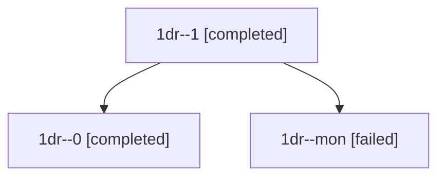

# Session: 1dr

[Agent Hoods](../README.md) / [bbugyi200](../users/bbugyi200/README.md) / [athena](../users/bbugyi200/machines/athena/README.md) / [1dr](../users/bbugyi200/machines/athena/hoods/1dr/README.md) / 1dr

Owner: `bbugyi200.athena` · Hood: `1dr` · Members: 3

## Lineage

The diagram is an optional enhancement; the ordered table below contains the same lineage in accessible text.

| Role | Agent | State | Model / provider | Timing | Commits | Prompt | Chat |
|---|---|---|---|---|---:|---|---|
| 1 | 1dr--1 | completed | gpt-6-astra / codex | 2026-11-17T22:57:56.213493+00:00 → 2026-11-17T23:02:21.388937+00:00 | [1](../agents/bbugyi200.athena.1dr--1/README.md#commits) | [Prompt](../agents/bbugyi200.athena.1dr--1/prompt.md) | [Chat](../agents/bbugyi200.athena.1dr--1/chat.md) |
| 0 | 1dr--0 | completed | gpt-6-astra / codex | 2026-11-17T22:17:29.366787+00:00 → 2026-11-17T22:34:00.340877+00:00 | 0 | [Prompt](../agents/bbugyi200.athena.1dr--0/prompt.md) | [Chat](../agents/bbugyi200.athena.1dr--0/chat.md) |
| mon | 1dr--mon | failed | gpt-6-astra / codex | 2026-11-17T22:33:06.377927+00:00 → 2026-11-17T22:57:56.493737+00:00 | 0 | — | [Chat](../agents/bbugyi200.athena.1dr--mon/chat.md) |

## Commits

| Role | Repo | Commit | Subject | Committed |
|---|---|---|---|---|
| 1 | sase | [`1e83f12`](https://github.com/sase-org/sase/commit/1e83f129814614886650390f79ecbac32d1139f6) | fix(macro): prevent generated-text guard markers from leaking | 2026-11-17 18:02:03 EST |
