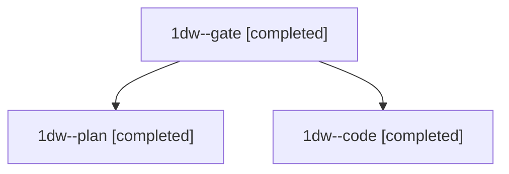

# Session: 1dw

[Agent Hoods](../README.md) / [bbugyi200](../users/bbugyi200/README.md) / [athena](../users/bbugyi200/machines/athena/README.md) / [1dw](../users/bbugyi200/machines/athena/hoods/1dw/README.md) / 1dw

Owner: `bbugyi200.athena` · Hood: `1dw` · Members: 3

## Lineage

The diagram is an optional enhancement; the ordered table below contains the same lineage in accessible text.

| Role | Agent | State | Model / provider | Timing | Commits | Prompt | Chat |
|---|---|---|---|---|---:|---|---|
| gate | 1dw--gate | completed | opus / claude | 2026-11-18T14:01:44.545219+00:00 → 2026-11-18T14:02:52.460507+00:00 | 0 | — | [Chat](../agents/bbugyi200.athena.1dw--gate/chat.md) |
| plan | 1dw--plan | completed | opus / claude | 2026-11-18T13:52:38.506196+00:00 → 2026-11-18T14:00:28.815398+00:00 | 0 | [Prompt](../agents/bbugyi200.athena.1dw--plan/prompt.md) | [Chat](../agents/bbugyi200.athena.1dw--plan/chat.md) |
| code | 1dw--code | completed | muse-spark-1.3-contributor / muse | 2026-11-18T14:03:14.757816+00:00 → 2026-11-18T14:44:20.551319+00:00 | [1](../agents/bbugyi200.athena.1dw--code/README.md#commits) | [Prompt](../agents/bbugyi200.athena.1dw--code/prompt.md) | [Chat](../agents/bbugyi200.athena.1dw--code/chat.md) |

## Commits

| Role | Repo | Commit | Subject | Committed |
|---|---|---|---|---|
| code | sase | [`637a70a`](https://github.com/sase-org/sase/commit/637a70a0f1b32b12dd5d768beafb4af7b0d3a7a7) | feat(sdd): report git timeouts as unknown state, never unsafe | 2026-11-18 09:44:04 EST |
