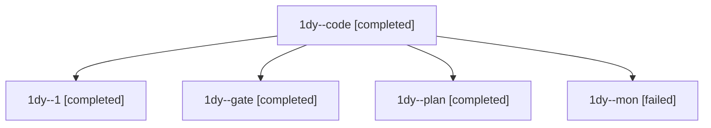

# Session: 1dy

[Agent Hoods](../README.md) / [bbugyi200](../users/bbugyi200/README.md) / [athena](../users/bbugyi200/machines/athena/README.md) / [1dy](../users/bbugyi200/machines/athena/hoods/1dy/README.md) / 1dy

Owner: `bbugyi200.athena` · Hood: `1dy` · Members: 5

## Lineage

The diagram is an optional enhancement; the ordered table below contains the same lineage in accessible text.

| Role | Agent | State | Model / provider | Timing | Commits | Prompt | Chat |
|---|---|---|---|---|---:|---|---|
| code | 1dy--code | completed | muse-spark-1.3-contributor / muse | 2026-11-18T14:54:46.814562+00:00 → 2026-11-18T15:17:30.792829+00:00 | 0 | [Prompt](../agents/bbugyi200.athena.1dy--code/prompt.md) | [Chat](../agents/bbugyi200.athena.1dy--code/chat.md) |
| 1 | 1dy--1 | completed | muse-spark-1.3-contributor / muse | 2026-11-18T15:37:53.142637+00:00 → 2026-11-18T15:59:32.194461+00:00 | [1](../agents/bbugyi200.athena.1dy--1/README.md#commits) | [Prompt](../agents/bbugyi200.athena.1dy--1/prompt.md) | [Chat](../agents/bbugyi200.athena.1dy--1/chat.md) |
| gate | 1dy--gate | completed | opus / claude | 2026-11-18T14:53:27.037992+00:00 → 2026-11-18T14:54:21.671754+00:00 | 0 | — | [Chat](../agents/bbugyi200.athena.1dy--gate/chat.md) |
| plan | 1dy--plan | completed | opus / claude | 2026-11-18T14:37:13.648125+00:00 → 2026-11-18T14:53:07.729795+00:00 | 0 | [Prompt](../agents/bbugyi200.athena.1dy--plan/prompt.md) | [Chat](../agents/bbugyi200.athena.1dy--plan/chat.md) |
| mon | 1dy--mon | failed | muse-spark-1.3-contributor / muse | 2026-11-18T15:16:14.654323+00:00 → 2026-11-18T15:37:53.244654+00:00 | 0 | — | [Chat](../agents/bbugyi200.athena.1dy--mon/chat.md) |

## Commits

| Role | Repo | Commit | Subject | Committed |
|---|---|---|---|---|
| 1 | sase | [`05a4a68`](https://github.com/sase-org/sase/commit/05a4a68fed62d713a49804085ee656136e6a2001) | feat(agent-names): wipe every session owner on forced reuse with older generations | 2026-11-18 10:59:16 EST |
