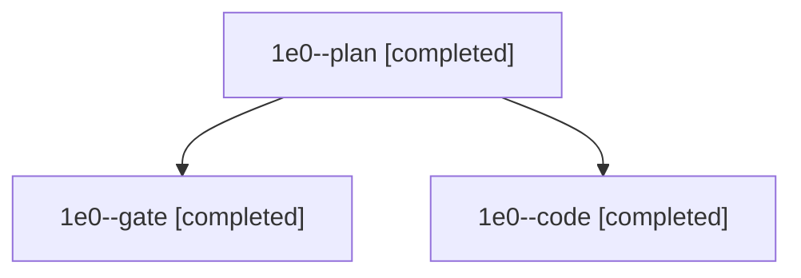

# Session: 1e0

[Agent Hoods](../README.md) / [bbugyi200](../users/bbugyi200/README.md) / [athena](../users/bbugyi200/machines/athena/README.md) / [1e0](../users/bbugyi200/machines/athena/hoods/1e0/README.md) / 1e0

Owner: `bbugyi200.athena` · Hood: `1e0` · Members: 3

## Lineage



The diagram is an optional enhancement; the ordered table below contains the same lineage in accessible text.

| Role | Agent | State | Model / provider | Timing | Commits | Prompt | Chat |
|---|---|---|---|---|---:|---|---|
| <a id="member-plan"></a>plan | 1e0--plan | completed | opus / claude | 2026-11-18T16:12:36.756076+00:00 → 2026-11-18T16:19:34.459601+00:00 | 0 | [Prompt](../agents/bbugyi200.athena.1e0--plan/prompt.md) | [Chat](../agents/bbugyi200.athena.1e0--plan/chat.md) |
| <a id="member-gate"></a>gate | 1e0--gate | completed | opus / claude | 2026-11-18T16:24:19.800321+00:00 → 2026-11-18T16:25:24.033258+00:00 | 0 | — | [Chat](../agents/bbugyi200.athena.1e0--gate/chat.md) |
| <a id="member-code"></a>code | 1e0--code | completed | gpt-6-luna / codex | 2026-11-18T16:25:48.395647+00:00 → 2026-11-18T18:04:33.020100+00:00 | [1](../agents/bbugyi200.athena.1e0--code/README.md#commits) | [Prompt](../agents/bbugyi200.athena.1e0--code/prompt.md) | [Chat](../agents/bbugyi200.athena.1e0--code/chat.md) |

## Commits

| Role | Repo | Commit | Subject | Committed |
|---|---|---|---|---|
| code | sase | [`9fda297`](https://github.com/sase-org/sase/commit/9fda297df0e02b83446a8f7942dbd86378a13bc6) | feat(tui): add prompt video previews | 2026-11-18 13:04:12 EST |

## Variables

| Role | Variable | Value |
|---|---|---|
| code | `artifacts` | \[{kind: file, label: just check failure log for launch and chop cancellation tests, path: /home/bryan/.sase/artifacts/agents/gh\_sase-org\_\_sase/20261118112523/stdout-9db4c7c4368e.log, ref: file:explic… |

#### artifacts

**Role:** `code`

```yaml
- kind: file
  label: just check failure log for launch and chop cancellation tests
  path: /home/bryan/.sase/artifacts/agents/gh_sase-org__sase/20261118112523/stdout-9db4c7c4368e.log
  ref: file:explicit:555cbeffb7d71f78742413d6
  source_path: /home/bryan/.sase/tools/logs/6a06e0823754c1c7dc7499d26219cc77/stdout.log
```

Values are truncated for display; see each member's agent meta.json for the full values.
