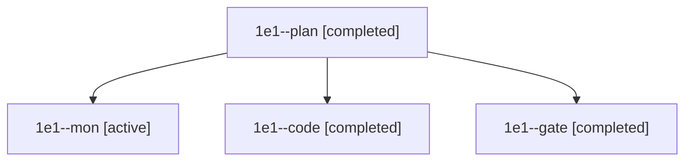

# Session: 1e1

[Agent Hoods](../README.md) / [bbugyi200](../users/bbugyi200/README.md) / [athena](../users/bbugyi200/machines/athena/README.md) / [1e1](../users/bbugyi200/machines/athena/hoods/1e1/README.md) / 1e1

Owner: `bbugyi200.athena` · Hood: `1e1` · Members: 4

## Lineage

The diagram is an optional enhancement; the ordered table below contains the same lineage in accessible text.

| Role | Agent | State | Model / provider | Timing | Commits | Prompt | Chat |
|---|---|---|---|---|---:|---|---|
| plan | 1e1--plan | completed | opus / claude | 2026-11-18T16:13:01.061538+00:00 → 2026-11-18T16:22:28.492182+00:00 | 0 | [Prompt](../agents/bbugyi200.athena.1e1--plan/prompt.md) | [Chat](../agents/bbugyi200.athena.1e1--plan/chat.md) |
| mon | 1e1--mon | active | muse-spark-1.3-contributor / muse | 2026-11-18T17:42:12.477294+00:00 | 0 | — | — |
| code | 1e1--code | completed | muse-spark-1.3-contributor / muse | 2026-11-18T16:25:00.361738+00:00 → 2026-11-18T17:45:01.801800+00:00 | [1](../agents/bbugyi200.athena.1e1--code/README.md#commits) | [Prompt](../agents/bbugyi200.athena.1e1--code/prompt.md) | [Chat](../agents/bbugyi200.athena.1e1--code/chat.md) |
| gate | 1e1--gate | completed | opus / claude | 2026-11-18T16:23:40.982075+00:00 → 2026-11-18T16:24:32.670372+00:00 | 0 | — | [Chat](../agents/bbugyi200.athena.1e1--gate/chat.md) |

## Commits

| Role | Repo | Commit | Subject | Committed |
|---|---|---|---|---|
| code | sase | [`1ccd5c0`](https://github.com/sase-org/sase/commit/1ccd5c0579ab8f9e3520040076be1ac8558e15fa) | feat(tui): queue dev updates behind in-flight epic launch instead of refusing | 2026-11-18 12:44:27 EST |
