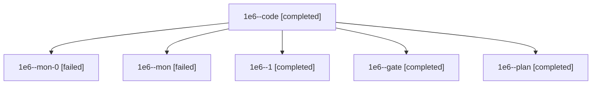

# Session: 1e6

[Agent Hoods](../README.md) / [bbugyi200](../users/bbugyi200/README.md) / [athena](../users/bbugyi200/machines/athena/README.md) / [1e6](../users/bbugyi200/machines/athena/hoods/1e6/README.md) / 1e6

Owner: `bbugyi200.athena` · Hood: `1e6` · Members: 6

## Lineage

The diagram is an optional enhancement; the ordered table below contains the same lineage in accessible text.

| Role | Agent | State | Model / provider | Timing | Commits | Prompt | Chat |
|---|---|---|---|---|---:|---|---|
| code | 1e6--code | completed | grok-4.6 / grok | 2026-11-18T23:59:49.124060+00:00 → 2026-11-19T00:28:52.342681+00:00 | 0 | [Prompt](../agents/bbugyi200.athena.1e6--code/prompt.md) | [Chat](../agents/bbugyi200.athena.1e6--code/chat.md) |
| mon-0 | 1e6--mon-0 | failed | grok-4.6 / grok | 2026-11-19T01:04:08.520594+00:00 → 2026-11-19T01:25:21.335883+00:00 | [1](../agents/bbugyi200.athena.1e6--mon-0/README.md#commits) | — | [Chat](../agents/bbugyi200.athena.1e6--mon-0/chat.md) |
| mon | 1e6--mon | failed | grok-4.6 / grok | 2026-11-19T00:27:46.516507+00:00 → 2026-11-19T00:54:55.306565+00:00 | 0 | — | [Chat](../agents/bbugyi200.athena.1e6--mon/chat.md) |
| 1 | 1e6--1 | completed | grok-4.6 / grok | 2026-11-19T00:54:54.950827+00:00 → 2026-11-19T01:05:28.412700+00:00 | 0 | [Prompt](../agents/bbugyi200.athena.1e6--1/prompt.md) | [Chat](../agents/bbugyi200.athena.1e6--1/chat.md) |
| gate | 1e6--gate | completed | opus / claude | 2026-11-18T23:58:52.256041+00:00 → 2026-11-18T23:59:26.583772+00:00 | 0 | — | [Chat](../agents/bbugyi200.athena.1e6--gate/chat.md) |
| plan | 1e6--plan | completed | opus / claude | 2026-11-18T23:43:50.235357+00:00 → 2026-11-18T23:57:57.765641+00:00 | 0 | [Prompt](../agents/bbugyi200.athena.1e6--plan/prompt.md) | [Chat](../agents/bbugyi200.athena.1e6--plan/chat.md) |

## Commits

| Role | Repo | Commit | Subject | Committed |
|---|---|---|---|---|
| mon-0 | sase | [`50c90e3`](https://github.com/sase-org/sase/commit/50c90e3f2f549a4259e17673fb56eba91edbf5f6) | feat(tui): keep Agents-tab j/k aligned with painted row order | 2026-11-18 20:25:05 EST |
