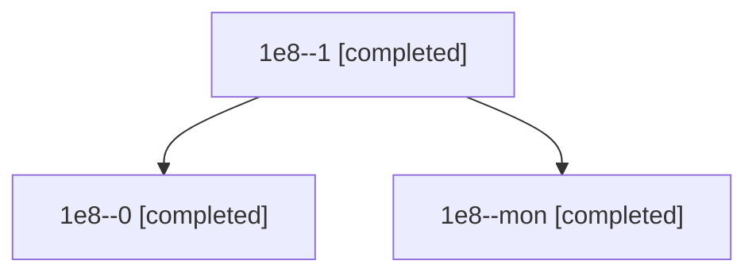

# Session: 1e8

[Agent Hoods](../README.md) / [bbugyi200](../users/bbugyi200/README.md) / [athena](../users/bbugyi200/machines/athena/README.md) / [1e8](../users/bbugyi200/machines/athena/hoods/1e8/README.md) / 1e8

Owner: `bbugyi200.athena` · Hood: `1e8` · Members: 3

## Lineage

The diagram is an optional enhancement; the ordered table below contains the same lineage in accessible text.

| Role | Agent | State | Model / provider | Timing | Commits | Prompt | Chat |
|---|---|---|---|---|---:|---|---|
| 1 | 1e8--1 | completed | opus / claude | 2026-11-19T10:22:16.238177+00:00 → 2026-11-19T10:23:53.687401+00:00 | 0 | [Prompt](../agents/bbugyi200.athena.1e8--1/prompt.md) | [Chat](../agents/bbugyi200.athena.1e8--1/chat.md) |
| 0 | 1e8--0 | completed | opus / claude | 2026-11-19T09:49:20.291943+00:00 → 2026-11-19T10:21:03.366393+00:00 | [1](../agents/bbugyi200.athena.1e8--0/README.md#commits) | [Prompt](../agents/bbugyi200.athena.1e8--0/prompt.md) | [Chat](../agents/bbugyi200.athena.1e8--0/chat.md) |
| mon | 1e8--mon | completed | opus / claude | 2026-11-19T10:19:41.938847+00:00 → 2026-11-19T10:22:16.702284+00:00 | 0 | — | [Chat](../agents/bbugyi200.athena.1e8--mon/chat.md) |

## Commits

| Role | Repo | Commit | Subject | Committed |
|---|---|---|---|---|
| 0 | sase | [`150fce3`](https://github.com/sase-org/sase/commit/150fce3735efec9d7c3a53ac104a69151f432250) | refactor(axe): retire the last sase-1tc.3.1 epic-symbol whitelist rows | 2026-11-19 05:20:43 EST |
