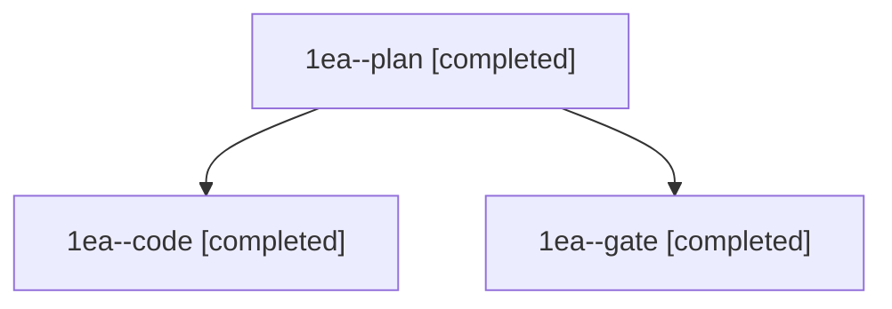

# Session: 1ea

[Agent Hoods](../README.md) / [bbugyi200](../users/bbugyi200/README.md) / [athena](../users/bbugyi200/machines/athena/README.md) / [1ea](../users/bbugyi200/machines/athena/hoods/1ea/README.md) / 1ea

Owner: `bbugyi200.athena` · Hood: `1ea` · Members: 3

## Lineage

The diagram is an optional enhancement; the ordered table below contains the same lineage in accessible text.

| Role | Agent | State | Model / provider | Timing | Commits | Prompt | Chat |
|---|---|---|---|---|---:|---|---|
| plan | 1ea--plan | completed | opus / claude | 2026-11-19T10:26:14.482268+00:00 → 2026-11-19T10:33:32.351768+00:00 | 0 | [Prompt](../agents/bbugyi200.athena.1ea--plan/prompt.md) | [Chat](../agents/bbugyi200.athena.1ea--plan/chat.md) |
| code | 1ea--code | completed | gpt-6-luna / codex | 2026-11-19T11:14:56.399760+00:00 → 2026-11-19T11:32:23.293953+00:00 | [1](../agents/bbugyi200.athena.1ea--code/README.md#commits) | [Prompt](../agents/bbugyi200.athena.1ea--code/prompt.md) | [Chat](../agents/bbugyi200.athena.1ea--code/chat.md) |
| gate | 1ea--gate | completed | opus / claude | 2026-11-19T11:14:01.742051+00:00 → 2026-11-19T11:14:35.097166+00:00 | 0 | — | [Chat](../agents/bbugyi200.athena.1ea--gate/chat.md) |

## Commits

| Role | Repo | Commit | Subject | Committed |
|---|---|---|---|---|
| code | sase | [`b188e55`](https://github.com/sase-org/sase/commit/b188e55ab03e15a16f55c6646debe05d76c19c18) | fix(axe): trust core chop generation matching | 2026-11-19 06:32:10 EST |
