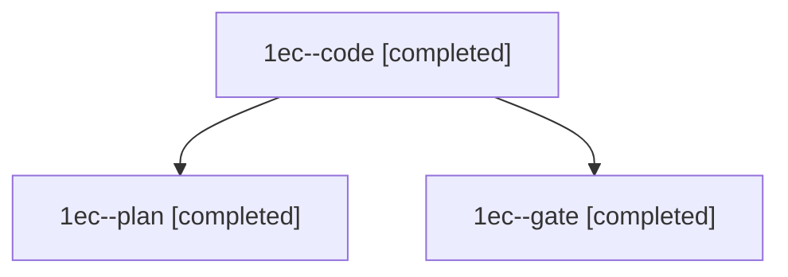

# Session: 1ec

[Agent Hoods](../README.md) / [bbugyi200](../users/bbugyi200/README.md) / [athena](../users/bbugyi200/machines/athena/README.md) / [1ec](../users/bbugyi200/machines/athena/hoods/1ec/README.md) / 1ec

Owner: `bbugyi200.athena` · Hood: `1ec` · Members: 3

## Lineage

The diagram is an optional enhancement; the ordered table below contains the same lineage in accessible text.

| Role | Agent | State | Model / provider | Timing | Commits | Prompt | Chat |
|---|---|---|---|---|---:|---|---|
| code | 1ec--code | completed | grok-4.6 / grok | 2026-11-19T12:20:54.866369+00:00 → 2026-11-19T12:54:59.282500+00:00 | [1](../agents/bbugyi200.athena.1ec--code/README.md#commits) | [Prompt](../agents/bbugyi200.athena.1ec--code/prompt.md) | [Chat](../agents/bbugyi200.athena.1ec--code/chat.md) |
| plan | 1ec--plan | completed | opus / claude | 2026-11-19T12:07:53.436554+00:00 → 2026-11-19T12:15:31.658459+00:00 | 0 | [Prompt](../agents/bbugyi200.athena.1ec--plan/prompt.md) | [Chat](../agents/bbugyi200.athena.1ec--plan/chat.md) |
| gate | 1ec--gate | completed | opus / claude | 2026-11-19T12:20:00.323080+00:00 → 2026-11-19T12:20:32.083498+00:00 | 0 | — | [Chat](../agents/bbugyi200.athena.1ec--gate/chat.md) |

## Commits

| Role | Repo | Commit | Subject | Committed |
|---|---|---|---|---|
| code | sase | [`6e1fc25`](https://github.com/sase-org/sase/commit/6e1fc2536f64eed4ced41fee946d0090c25780ed) | fix(monitor): reserve staged joins with the ToolRun starter identity | 2026-11-19 07:54:31 EST |
