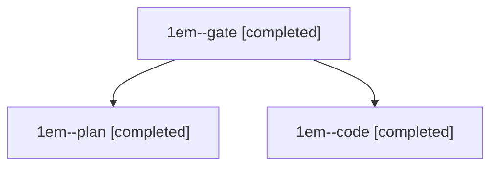

# Session: 1em

[Agent Hoods](../README.md) / [bbugyi200](../users/bbugyi200/README.md) / [athena](../users/bbugyi200/machines/athena/README.md) / [1em](../users/bbugyi200/machines/athena/hoods/1em/README.md) / 1em

Owner: `bbugyi200.athena` · Hood: `1em` · Members: 3

## Lineage

The diagram is an optional enhancement; the ordered table below contains the same lineage in accessible text.

| Role | Agent | State | Model / provider | Timing | Commits | Prompt | Chat |
|---|---|---|---|---|---:|---|---|
| gate | 1em--gate | completed | opus / claude | 2026-11-20T16:19:57.647060+00:00 → 2026-11-20T16:20:58.275149+00:00 | 0 | — | [Chat](../agents/bbugyi200.athena.1em--gate/chat.md) |
| plan | 1em--plan | completed | opus / claude | 2026-11-20T16:07:06.026905+00:00 → 2026-11-20T16:19:40.127931+00:00 | 0 | [Prompt](../agents/bbugyi200.athena.1em--plan/prompt.md) | [Chat](../agents/bbugyi200.athena.1em--plan/chat.md) |
| code | 1em--code | completed | opus / claude | 2026-11-20T16:21:21.555662+00:00 → 2026-11-20T17:51:19.952667+00:00 | [1](../agents/bbugyi200.athena.1em--code/README.md#commits) | [Prompt](../agents/bbugyi200.athena.1em--code/prompt.md) | [Chat](../agents/bbugyi200.athena.1em--code/chat.md) |

## Commits

| Role | Repo | Commit | Subject | Committed |
|---|---|---|---|---|
| code | sase | [`6ab880a`](https://github.com/sase-org/sase/commit/6ab880ad623788e9b7933233253926fc1f3633eb) | fix(ace): keep clan rows in progress while a failed monitor is still settling | 2026-11-20 12:50:48 EST |
