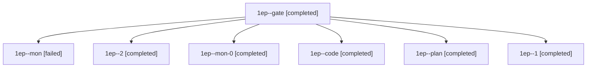

# Session: 1ep

[Agent Hoods](../README.md) / [bbugyi200](../users/bbugyi200/README.md) / [athena](../users/bbugyi200/machines/athena/README.md) / [1ep](../users/bbugyi200/machines/athena/hoods/1ep/README.md) / 1ep

Owner: `bbugyi200.athena` · Hood: `1ep` · Members: 7

## Lineage

The diagram is an optional enhancement; the ordered table below contains the same lineage in accessible text.

| Role | Agent | State | Model / provider | Timing | Commits | Prompt | Chat |
|---|---|---|---|---|---:|---|---|
| gate | 1ep--gate | completed | opus / claude | 2026-11-20T23:05:22.154327+00:00 → 2026-11-20T23:05:57.169249+00:00 | 0 | — | [Chat](../agents/bbugyi200.athena.1ep--gate/chat.md) |
| mon | 1ep--mon | failed | grok-4.6 / grok | 2026-11-20T23:19:12.062983+00:00 → 2026-11-20T23:51:00.092237+00:00 | 0 | — | [Chat](../agents/bbugyi200.athena.1ep--mon/chat.md) |
| 2 | 1ep--2 | completed | grok-4.6 / grok | 2026-11-21T00:31:25.961556+00:00 → 2026-11-21T00:34:43.263435+00:00 | [1](../agents/bbugyi200.athena.1ep--2/README.md#commits) | [Prompt](../agents/bbugyi200.athena.1ep--2/prompt.md) | [Chat](../agents/bbugyi200.athena.1ep--2/chat.md) |
| mon-0 | 1ep--mon-0 | completed | grok-4.6 / grok | 2026-11-20T23:54:05.543571+00:00 → 2026-11-21T00:31:00.253626+00:00 | 0 | — | [Chat](../agents/bbugyi200.athena.1ep--mon-0/chat.md) |
| code | 1ep--code | completed | grok-4.6 / grok | 2026-11-20T23:06:20.395264+00:00 → 2026-11-20T23:20:14.869775+00:00 | 0 | [Prompt](../agents/bbugyi200.athena.1ep--code/prompt.md) | [Chat](../agents/bbugyi200.athena.1ep--code/chat.md) |
| plan | 1ep--plan | completed | opus / claude | 2026-11-20T22:53:18.122898+00:00 → 2026-11-20T23:02:45.427845+00:00 | 0 | [Prompt](../agents/bbugyi200.athena.1ep--plan/prompt.md) | [Chat](../agents/bbugyi200.athena.1ep--plan/chat.md) |
| 1 | 1ep--1 | completed | grok-4.6 / grok | 2026-11-20T23:50:59.921868+00:00 → 2026-11-20T23:55:12.963449+00:00 | 0 | [Prompt](../agents/bbugyi200.athena.1ep--1/prompt.md) | [Chat](../agents/bbugyi200.athena.1ep--1/chat.md) |

## Commits

| Role | Repo | Commit | Subject | Committed |
|---|---|---|---|---|
| 2 | sase | [`815afd1`](https://github.com/sase-org/sase/commit/815afd140697bda1baeef8e095822c91bf296cf1) | fix(hijack): treat live working-plan display labels as RUNNING | 2026-11-20 19:34:29 EST |
