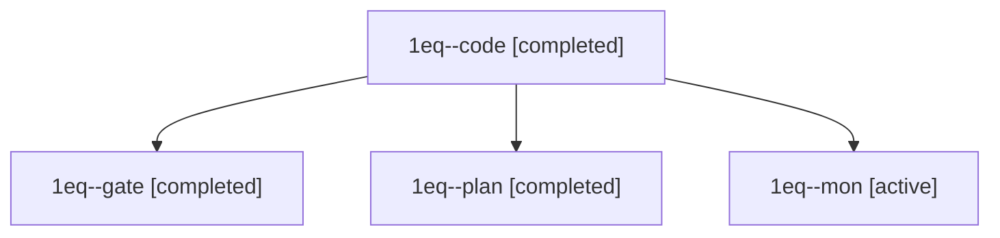

# Session: 1eq

[Agent Hoods](../README.md) / [bbugyi200](../users/bbugyi200/README.md) / [athena](../users/bbugyi200/machines/athena/README.md) / [1eq](../users/bbugyi200/machines/athena/hoods/1eq/README.md) / 1eq

Owner: `bbugyi200.athena` · Hood: `1eq` · Members: 4

## Lineage

The diagram is an optional enhancement; the ordered table below contains the same lineage in accessible text.

| Role | Agent | State | Model / provider | Timing | Commits | Prompt | Chat |
|---|---|---|---|---|---:|---|---|
| code | 1eq--code | completed | muse-spark-1.3-contributor / muse | 2026-11-20T23:15:26.251746+00:00 → 2026-11-20T23:45:03.068321+00:00 | [1](../agents/bbugyi200.athena.1eq--code/README.md#commits) | [Prompt](../agents/bbugyi200.athena.1eq--code/prompt.md) | [Chat](../agents/bbugyi200.athena.1eq--code/chat.md) |
| gate | 1eq--gate | completed | opus / claude | 2026-11-20T23:14:14.381975+00:00 → 2026-11-20T23:15:04.029334+00:00 | 0 | — | [Chat](../agents/bbugyi200.athena.1eq--gate/chat.md) |
| plan | 1eq--plan | completed | opus / claude | 2026-11-20T22:57:55.360277+00:00 → 2026-11-20T23:13:48.581182+00:00 | 0 | [Prompt](../agents/bbugyi200.athena.1eq--plan/prompt.md) | [Chat](../agents/bbugyi200.athena.1eq--plan/chat.md) |
| mon | 1eq--mon | active | muse-spark-1.3-contributor / muse | 2026-11-20T23:42:52.736101+00:00 | 0 | — | — |

## Commits

| Role | Repo | Commit | Subject | Committed |
|---|---|---|---|---|
| code | sase | [`92dc627`](https://github.com/sase-org/sase/commit/92dc6274e51931cf546c9551b7cd855eac37773c) | perf(housekeeping): speed up artifact retention scans and add phase progress | 2026-11-20 18:44:32 EST |
