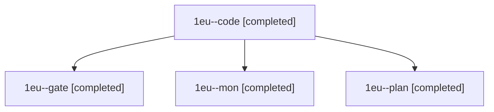

# Session: 1eu

[Agent Hoods](../README.md) / [bbugyi200](../users/bbugyi200/README.md) / [athena](../users/bbugyi200/machines/athena/README.md) / [1eu](../users/bbugyi200/machines/athena/hoods/1eu/README.md) / 1eu

Owner: `bbugyi200.athena` · Hood: `1eu` · Members: 4

## Lineage

The diagram is an optional enhancement; the ordered table below contains the same lineage in accessible text.

| Role | Agent | State | Model / provider | Timing | Commits | Prompt | Chat |
|---|---|---|---|---|---:|---|---|
| code | 1eu--code | completed | grok-4.6 / grok | 2026-11-21T15:12:19.996472+00:00 → 2026-11-21T15:22:48.279003+00:00 | 0 | [Prompt](../agents/bbugyi200.athena.1eu--code/prompt.md) | [Chat](../agents/bbugyi200.athena.1eu--code/chat.md) |
| gate | 1eu--gate | completed | opus / claude | 2026-11-21T15:11:04.501516+00:00 → 2026-11-21T15:11:57.716645+00:00 | 0 | — | [Chat](../agents/bbugyi200.athena.1eu--gate/chat.md) |
| mon | 1eu--mon | completed | grok-4.6 / grok | 2026-11-21T15:21:44.953726+00:00 → 2026-11-21T15:51:32.808094+00:00 | [1](../agents/bbugyi200.athena.1eu--mon/README.md#commits) | — | [Chat](../agents/bbugyi200.athena.1eu--mon/chat.md) |
| plan | 1eu--plan | completed | opus / claude | 2026-11-21T14:59:05.541155+00:00 → 2026-11-21T15:09:16.264657+00:00 | 0 | [Prompt](../agents/bbugyi200.athena.1eu--plan/prompt.md) | [Chat](../agents/bbugyi200.athena.1eu--plan/chat.md) |

## Commits

| Role | Repo | Commit | Subject | Committed |
|---|---|---|---|---|
| mon | sase | [`dfc0866`](https://github.com/sase-org/sase/commit/dfc086636041669f393f232df4cad06836b2ed58) | fix(tui): survive pruned PromptTextArea compositor repaints | 2026-11-21 10:51:19 EST |
