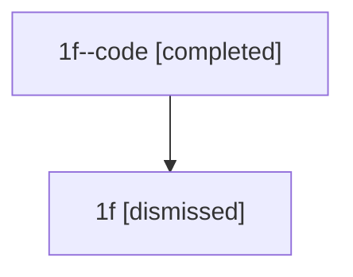

# Session: 1f

[Agent Hoods](../README.md) / [bbugyi200](../users/bbugyi200/README.md) / [athena](../users/bbugyi200/machines/athena/README.md) / [1f](../users/bbugyi200/machines/athena/hoods/1f/README.md) / 1f

Owner: `bbugyi200.athena` · Hood: `1f` · Members: 2

## Lineage

The diagram is an optional enhancement; the ordered table below contains the same lineage in accessible text.

| Role | Agent | State | Model / provider | Timing | Commits | Prompt | Chat |
|---|---|---|---|---|---:|---|---|
| code | 1f--code | completed | gpt-5.5 / codex | 2026-07-08T00:52:56.656413+00:00 | [1](../agents/bbugyi200.athena.1f--code/README.md#commits) | — | [Chat](../agents/bbugyi200.athena.1f--code/chat.md) |
| root | 1f | dismissed | opus / claude | 2026-07-07T20:38:28.474640 → 2026-07-07T21:19:52.209350 | [1](../agents/bbugyi200.athena.1f/README.md#commits) | [Prompt](../agents/bbugyi200.athena.1f/prompt.md) | [Chat](../agents/bbugyi200.athena.1f/chat.md) |

## Commits

| Role | Repo | Commit | Subject | Committed |
|---|---|---|---|---|
| root | — | `755d33f` | chore: Add SDD prompt and plan for zoom\_panel\_file\_list | 2026-07-07 20:52:55 EDT |
| code | — | `c43cd35` | feat(ace): add frozen zoom file rail | 2026-07-07 21:19:33 EDT |
