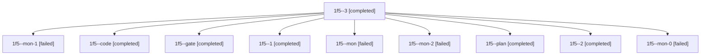

# Session: 1f5

[Agent Hoods](../README.md) / [bbugyi200](../users/bbugyi200/README.md) / [athena](../users/bbugyi200/machines/athena/README.md) / [1f5](../users/bbugyi200/machines/athena/hoods/1f5/README.md) / 1f5

Owner: `bbugyi200.athena` · Hood: `1f5` · Members: 10

## Lineage

The diagram is an optional enhancement; the ordered table below contains the same lineage in accessible text.

| Role | Agent | State | Model / provider | Timing | Commits | Prompt | Chat |
|---|---|---|---|---|---:|---|---|
| 3 | 1f5--3 | completed | grok-4.6 / grok | 2026-11-22T16:10:10.977493+00:00 → 2026-11-22T16:17:57.966462+00:00 | 0 | [Prompt](../agents/bbugyi200.athena.1f5--3/prompt.md) | [Chat](../agents/bbugyi200.athena.1f5--3/chat.md) |
| mon-1 | 1f5--mon-1 | failed | grok-4.6 / grok | 2026-11-22T15:18:59.581547+00:00 → 2026-11-22T16:10:11.366095+00:00 | 0 | — | [Chat](../agents/bbugyi200.athena.1f5--mon-1/chat.md) |
| code | 1f5--code | completed | grok-4.6 / grok | 2026-11-22T14:00:14.930416+00:00 → 2026-11-22T14:09:31.543198+00:00 | 0 | [Prompt](../agents/bbugyi200.athena.1f5--code/prompt.md) | [Chat](../agents/bbugyi200.athena.1f5--code/chat.md) |
| gate | 1f5--gate | completed | opus / claude | 2026-11-22T13:34:46.533361+00:00 → 2026-11-22T13:47:34.625321+00:00 | 0 | — | [Chat](../agents/bbugyi200.athena.1f5--gate/chat.md) |
| 1 | 1f5--1 | completed | grok-4.6 / grok | 2026-11-22T14:15:00.454151+00:00 → 2026-11-22T14:26:39.701752+00:00 | 0 | [Prompt](../agents/bbugyi200.athena.1f5--1/prompt.md) | [Chat](../agents/bbugyi200.athena.1f5--1/chat.md) |
| mon | 1f5--mon | failed | grok-4.6 / grok | 2026-11-22T14:08:08.493317+00:00 → 2026-11-22T14:15:00.764303+00:00 | 0 | — | [Chat](../agents/bbugyi200.athena.1f5--mon/chat.md) |
| mon-2 | 1f5--mon-2 | failed | grok-4.6 / grok | 2026-11-22T16:16:18.289976+00:00 → 2026-11-22T17:02:35.674158+00:00 | [1](../agents/bbugyi200.athena.1f5--mon-2/README.md#commits) | — | [Chat](../agents/bbugyi200.athena.1f5--mon-2/chat.md) |
| plan | 1f5--plan | completed | opus / claude | 2026-11-22T13:26:23.547551+00:00 → 2026-11-22T13:34:51.957276+00:00 | 0 | [Prompt](../agents/bbugyi200.athena.1f5--plan/prompt.md) | [Chat](../agents/bbugyi200.athena.1f5--plan/chat.md) |
| 2 | 1f5--2 | completed | grok-4.6 / grok | 2026-11-22T15:07:08.915192+00:00 → 2026-11-22T15:20:37.485716+00:00 | 0 | [Prompt](../agents/bbugyi200.athena.1f5--2/prompt.md) | [Chat](../agents/bbugyi200.athena.1f5--2/chat.md) |
| mon-0 | 1f5--mon-0 | failed | grok-4.6 / grok | 2026-11-22T14:25:05.936725+00:00 → 2026-11-22T15:07:09.027491+00:00 | 0 | — | [Chat](../agents/bbugyi200.athena.1f5--mon-0/chat.md) |

## Commits

| Role | Repo | Commit | Subject | Committed |
|---|---|---|---|---|
| mon-2 | sase | [`8cfdf6c`](https://github.com/sase-org/sase/commit/8cfdf6c2ee1488a312d29af8596957ee2eda5386) | fix(running-field): lazy-export occupancy names and repair HEAD tests | 2026-11-22 12:02:23 EST |
