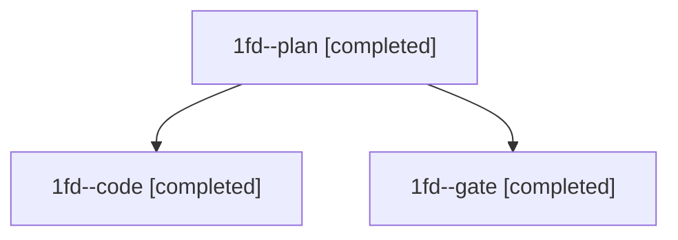

# Session: 1fd

[Agent Hoods](../README.md) / [bbugyi200](../users/bbugyi200/README.md) / [athena](../users/bbugyi200/machines/athena/README.md) / [1fd](../users/bbugyi200/machines/athena/hoods/1fd/README.md) / 1fd

Owner: `bbugyi200.athena` · Hood: `1fd` · Members: 3

## Lineage

The diagram is an optional enhancement; the ordered table below contains the same lineage in accessible text.

| Role | Agent | State | Model / provider | Timing | Commits | Prompt | Chat |
|---|---|---|---|---|---:|---|---|
| plan | 1fd--plan | completed | opus / claude | 2026-11-22T23:43:52.066442+00:00 → 2026-11-23T00:05:27.248488+00:00 | 0 | [Prompt](../agents/bbugyi200.athena.1fd--plan/prompt.md) | [Chat](../agents/bbugyi200.athena.1fd--plan/chat.md) |
| code | 1fd--code | completed | gpt-6-luna / codex | 2026-11-23T00:07:37.502087+00:00 → 2026-11-23T01:16:50.553808+00:00 | [1](../agents/bbugyi200.athena.1fd--code/README.md#commits) | [Prompt](../agents/bbugyi200.athena.1fd--code/prompt.md) | [Chat](../agents/bbugyi200.athena.1fd--code/chat.md) |
| gate | 1fd--gate | completed | opus / claude | 2026-11-23T00:06:22.213045+00:00 → 2026-11-23T00:07:13.494354+00:00 | 0 | — | [Chat](../agents/bbugyi200.athena.1fd--gate/chat.md) |

## Commits

| Role | Repo | Commit | Subject | Committed |
|---|---|---|---|---|
| code | sase | [`25c936a`](https://github.com/sase-org/sase/commit/25c936a4f28933c0ecb8b2ae1c8eea38daa8dfd3) | fix(tui): resolve deterministic master gate failures | 2026-11-22 20:16:34 EST |
