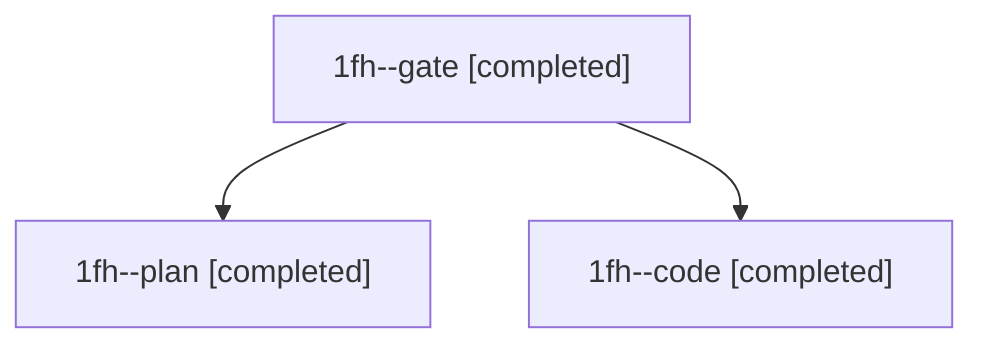

# Session: 1fh

[Agent Hoods](../README.md) / [bbugyi200](../users/bbugyi200/README.md) / [athena](../users/bbugyi200/machines/athena/README.md) / [1fh](../users/bbugyi200/machines/athena/hoods/1fh/README.md) / 1fh

Owner: `bbugyi200.athena` · Hood: `1fh` · Members: 3

## Lineage

The diagram is an optional enhancement; the ordered table below contains the same lineage in accessible text.

| Role | Agent | State | Model / provider | Timing | Commits | Prompt | Chat |
|---|---|---|---|---|---:|---|---|
| gate | 1fh--gate | completed | opus / claude | 2026-11-23T13:00:28.357280+00:00 → 2026-11-23T13:01:03.705102+00:00 | 0 | — | [Chat](../agents/bbugyi200.athena.1fh--gate/chat.md) |
| plan | 1fh--plan | completed | opus / claude | 2026-11-23T12:50:00.513102+00:00 → 2026-11-23T13:00:07.955206+00:00 | 0 | [Prompt](../agents/bbugyi200.athena.1fh--plan/prompt.md) | [Chat](../agents/bbugyi200.athena.1fh--plan/chat.md) |
| code | 1fh--code | completed | grok-4.6 / grok | 2026-11-23T13:01:59.505914+00:00 → 2026-11-23T14:16:52.385761+00:00 | [1](../agents/bbugyi200.athena.1fh--code/README.md#commits) | [Prompt](../agents/bbugyi200.athena.1fh--code/prompt.md) | [Chat](../agents/bbugyi200.athena.1fh--code/chat.md) |

## Commits

| Role | Repo | Commit | Subject | Committed |
|---|---|---|---|---|
| code | sase | [`bf7f274`](https://github.com/sase-org/sase/commit/bf7f2741784d73302ab0d3580fa550a2ebd25abf) | fix: bootstrap just fix lazily and fast-forward new external clones | 2026-11-23 09:16:38 EST |
