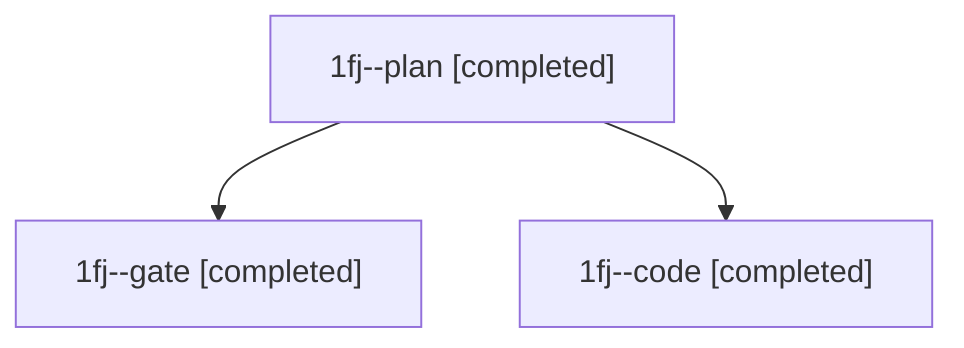

# Session: 1fj

[Agent Hoods](../README.md) / [bbugyi200](../users/bbugyi200/README.md) / [athena](../users/bbugyi200/machines/athena/README.md) / [1fj](../users/bbugyi200/machines/athena/hoods/1fj/README.md) / 1fj

Owner: `bbugyi200.athena` · Hood: `1fj` · Members: 3

## Lineage

The diagram is an optional enhancement; the ordered table below contains the same lineage in accessible text.

| Role | Agent | State | Model / provider | Timing | Commits | Prompt | Chat |
|---|---|---|---|---|---:|---|---|
| plan | 1fj--plan | completed | opus / claude | 2026-11-23T14:30:06.106143+00:00 → 2026-11-23T14:43:03.642847+00:00 | 0 | [Prompt](../agents/bbugyi200.athena.1fj--plan/prompt.md) | [Chat](../agents/bbugyi200.athena.1fj--plan/chat.md) |
| gate | 1fj--gate | completed | opus / claude | 2026-11-23T14:45:33.149610+00:00 → 2026-11-23T14:47:54.930327+00:00 | 0 | — | [Chat](../agents/bbugyi200.athena.1fj--gate/chat.md) |
| code | 1fj--code | completed | gpt-6-luna / codex | 2026-11-23T14:48:28.851544+00:00 → 2026-11-23T15:42:49.779208+00:00 | [1](../agents/bbugyi200.athena.1fj--code/README.md#commits) | [Prompt](../agents/bbugyi200.athena.1fj--code/prompt.md) | [Chat](../agents/bbugyi200.athena.1fj--code/chat.md) |

## Commits

| Role | Repo | Commit | Subject | Committed |
|---|---|---|---|---|
| code | sase | [`4e3aab4`](https://github.com/sase-org/sase/commit/4e3aab4f169f93d43fb1213243900bf7f75ac360) | fix(agents): preserve prompt sources for deferred publication | 2026-11-23 10:42:34 EST |
