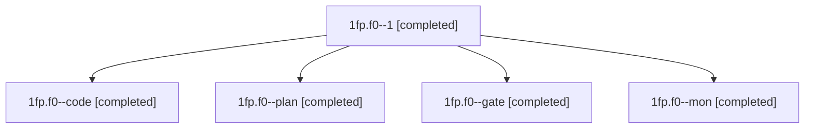

# Session: 1fp.f0

[Agent Hoods](../README.md) / [bbugyi200](../users/bbugyi200/README.md) / [athena](../users/bbugyi200/machines/athena/README.md) / [1fp](../users/bbugyi200/machines/athena/hoods/1fp/README.md) / 1fp.f0

Owner: `bbugyi200.athena` · Hood: `1fp` · Members: 5

## Lineage

The diagram is an optional enhancement; the ordered table below contains the same lineage in accessible text.

| Role | Agent | State | Model / provider | Timing | Commits | Prompt | Chat |
|---|---|---|---|---|---:|---|---|
| 1 | 1fp.f0--1 | completed | muse-spark-1.3-contributor / muse | 2026-11-24T15:22:44.135386+00:00 → 2026-11-24T15:25:30.265328+00:00 | [1](../agents/bbugyi200.athena.1fp.f0--1/README.md#commits) | [Prompt](../agents/bbugyi200.athena.1fp.f0--1/prompt.md) | [Chat](../agents/bbugyi200.athena.1fp.f0--1/chat.md) |
| code | 1fp.f0--code | completed | muse-spark-1.3-contributor / muse | 2026-11-24T14:47:04.210372+00:00 → 2026-11-24T15:21:22.251996+00:00 | 0 | [Prompt](../agents/bbugyi200.athena.1fp.f0--code/prompt.md) | [Chat](../agents/bbugyi200.athena.1fp.f0--code/chat.md) |
| plan | 1fp.f0--plan | completed | opus / claude | 2026-11-24T14:36:50.508829+00:00 → 2026-11-24T14:45:32.848136+00:00 | 0 | [Prompt](../agents/bbugyi200.athena.1fp.f0--plan/prompt.md) | [Chat](../agents/bbugyi200.athena.1fp.f0--plan/chat.md) |
| gate | 1fp.f0--gate | completed | opus / claude | 2026-11-24T14:45:55.379189+00:00 → 2026-11-24T14:46:43.332270+00:00 | 0 | — | [Chat](../agents/bbugyi200.athena.1fp.f0--gate/chat.md) |
| mon | 1fp.f0--mon | completed | muse-spark-1.3-contributor / muse | 2026-11-24T15:20:14.030833+00:00 → 2026-11-24T15:22:44.286401+00:00 | 0 | — | [Chat](../agents/bbugyi200.athena.1fp.f0--mon/chat.md) |

## Commits

| Role | Repo | Commit | Subject | Committed |
|---|---|---|---|---|
| 1 | sase | [`232204f`](https://github.com/sase-org/sase/commit/232204f5f8babb45a3ed5788d8396fbc40edf279) | feat(ace-tui): jump l to clan lone failed member or session failed turn | 2026-11-24 10:25:05 EST |

## Neighbors

| Agent | Relation | State |
|---|---|---|
| [1fp](bbugyi200.athena.1fp.md) (session · 10) | ancestor | completed 7, failed 3 |
