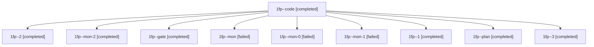

# Session: 1fp

[Agent Hoods](../README.md) / [bbugyi200](../users/bbugyi200/README.md) / [athena](../users/bbugyi200/machines/athena/README.md) / [1fp](../users/bbugyi200/machines/athena/hoods/1fp/README.md) / 1fp

Owner: `bbugyi200.athena` · Hood: `1fp` · Members: 10

## Lineage

The diagram is an optional enhancement; the ordered table below contains the same lineage in accessible text.

| Role | Agent | State | Model / provider | Timing | Commits | Prompt | Chat |
|---|---|---|---|---|---:|---|---|
| code | 1fp--code | completed | grok-4.6 / grok | 2026-11-24T12:24:21.815625+00:00 → 2026-11-24T12:37:21.677122+00:00 | 0 | [Prompt](../agents/bbugyi200.athena.1fp--code/prompt.md) | [Chat](../agents/bbugyi200.athena.1fp--code/chat.md) |
| 2 | 1fp--2 | completed | grok-4.6 / grok | 2026-11-24T13:37:18.719069+00:00 → 2026-11-24T13:48:42.269675+00:00 | 0 | [Prompt](../agents/bbugyi200.athena.1fp--2/prompt.md) | [Chat](../agents/bbugyi200.athena.1fp--2/chat.md) |
| mon-2 | 1fp--mon-2 | completed | grok-4.6 / grok | 2026-11-24T14:14:15.728947+00:00 → 2026-11-24T14:36:14.272264+00:00 | [1](../agents/bbugyi200.athena.1fp--mon-2/README.md#commits) | — | [Chat](../agents/bbugyi200.athena.1fp--mon-2/chat.md) |
| gate | 1fp--gate | completed | opus / claude | 2026-11-24T12:23:11.713959+00:00 → 2026-11-24T12:24:00.407627+00:00 | 0 | — | [Chat](../agents/bbugyi200.athena.1fp--gate/chat.md) |
| mon | 1fp--mon | failed | grok-4.6 / grok | 2026-11-24T12:35:58.838404+00:00 → 2026-11-24T13:02:31.740201+00:00 | 0 | — | [Chat](../agents/bbugyi200.athena.1fp--mon/chat.md) |
| mon-0 | 1fp--mon-0 | failed | grok-4.6 / grok | 2026-11-24T13:14:00.415785+00:00 → 2026-11-24T13:37:18.977911+00:00 | 0 | — | [Chat](../agents/bbugyi200.athena.1fp--mon-0/chat.md) |
| mon-1 | 1fp--mon-1 | failed | grok-4.6 / grok | 2026-11-24T13:47:28.971916+00:00 → 2026-11-24T14:10:02.183876+00:00 | 0 | — | [Chat](../agents/bbugyi200.athena.1fp--mon-1/chat.md) |
| 1 | 1fp--1 | completed | grok-4.6 / grok | 2026-11-24T13:02:31.298139+00:00 → 2026-11-24T13:15:14.740394+00:00 | 0 | [Prompt](../agents/bbugyi200.athena.1fp--1/prompt.md) | [Chat](../agents/bbugyi200.athena.1fp--1/chat.md) |
| plan | 1fp--plan | completed | opus / claude | 2026-11-24T11:58:01.447966+00:00 → 2026-11-24T12:09:41.280920+00:00 | 0 | [Prompt](../agents/bbugyi200.athena.1fp--plan/prompt.md) | [Chat](../agents/bbugyi200.athena.1fp--plan/chat.md) |
| 3 | 1fp--3 | completed | grok-4.6 / grok | 2026-11-24T14:10:02.097971+00:00 → 2026-11-24T14:15:35.433338+00:00 | 0 | [Prompt](../agents/bbugyi200.athena.1fp--3/prompt.md) | [Chat](../agents/bbugyi200.athena.1fp--3/chat.md) |

## Commits

| Role | Repo | Commit | Subject | Committed |
|---|---|---|---|---|
| mon-2 | sase | [`8ea12e5`](https://github.com/sase-org/sase/commit/8ea12e585590c32dfc5d7f77e522d9575e770d18) | feat(ace-tui): jump agents-tab l to a session's lone running monitor | 2026-11-24 09:36:00 EST |

## Neighbors

| Agent | Relation | State |
|---|---|---|
| [1fp.f0](bbugyi200.athena.1fp.f0.md) (session · 5) | descendant | completed 5 |
