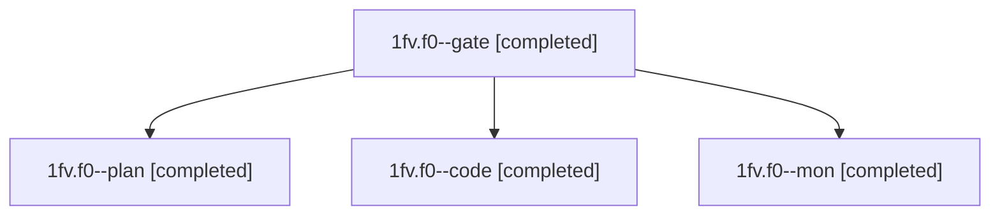

# Session: 1fv.f0

[Agent Hoods](../README.md) / [bbugyi200](../users/bbugyi200/README.md) / [athena](../users/bbugyi200/machines/athena/README.md) / [1fv](../users/bbugyi200/machines/athena/hoods/1fv/README.md) / 1fv.f0

Owner: `bbugyi200.athena` · Hood: `1fv` · Members: 4

## Lineage

The diagram is an optional enhancement; the ordered table below contains the same lineage in accessible text.

| Role | Agent | State | Model / provider | Timing | Commits | Prompt | Chat |
|---|---|---|---|---|---:|---|---|
| gate | 1fv.f0--gate | completed | opus / claude | 2026-11-25T12:59:54.451662+00:00 → 2026-11-25T13:00:43.339629+00:00 | 0 | — | [Chat](../agents/bbugyi200.athena.1fv.f0--gate/chat.md) |
| plan | 1fv.f0--plan | completed | opus / claude | 2026-11-25T12:53:41.681131+00:00 → 2026-11-25T12:59:28.518553+00:00 | 0 | [Prompt](../agents/bbugyi200.athena.1fv.f0--plan/prompt.md) | [Chat](../agents/bbugyi200.athena.1fv.f0--plan/chat.md) |
| code | 1fv.f0--code | completed | gpt-6-luna / codex | 2026-11-25T13:01:04.430531+00:00 → 2026-11-25T13:04:41.058496+00:00 | 0 | [Prompt](../agents/bbugyi200.athena.1fv.f0--code/prompt.md) | [Chat](../agents/bbugyi200.athena.1fv.f0--code/chat.md) |
| mon | 1fv.f0--mon | completed | gpt-6-luna / codex | 2026-11-25T13:03:33.149753+00:00 → 2026-11-25T13:04:51.849580+00:00 | 0 | — | [Chat](../agents/bbugyi200.athena.1fv.f0--mon/chat.md) |

## Neighbors

| Agent | Relation | State |
|---|---|---|
| [1fv](bbugyi200.athena.1fv.md) (session · 3) | ancestor | completed 3 |
