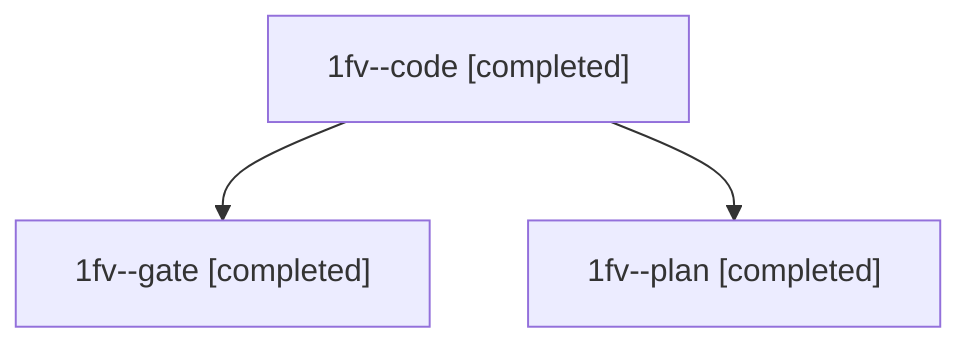

# Session: 1fv

[Agent Hoods](../README.md) / [bbugyi200](../users/bbugyi200/README.md) / [athena](../users/bbugyi200/machines/athena/README.md) / [1fv](../users/bbugyi200/machines/athena/hoods/1fv/README.md) / 1fv

Owner: `bbugyi200.athena` · Hood: `1fv` · Members: 3

## Lineage

The diagram is an optional enhancement; the ordered table below contains the same lineage in accessible text.

| Role | Agent | State | Model / provider | Timing | Commits | Prompt | Chat |
|---|---|---|---|---|---:|---|---|
| code | 1fv--code | completed | gpt-6-luna / codex | 2026-11-25T12:04:02.364689+00:00 → 2026-11-25T12:53:17.382615+00:00 | [1](../agents/bbugyi200.athena.1fv--code/README.md#commits) | [Prompt](../agents/bbugyi200.athena.1fv--code/prompt.md) | [Chat](../agents/bbugyi200.athena.1fv--code/chat.md) |
| gate | 1fv--gate | completed | opus / claude | 2026-11-25T12:02:51.987323+00:00 → 2026-11-25T12:03:40.489251+00:00 | 0 | — | [Chat](../agents/bbugyi200.athena.1fv--gate/chat.md) |
| plan | 1fv--plan | completed | opus / claude | 2026-11-25T11:52:18.565128+00:00 → 2026-11-25T12:02:09.016675+00:00 | 0 | [Prompt](../agents/bbugyi200.athena.1fv--plan/prompt.md) | [Chat](../agents/bbugyi200.athena.1fv--plan/chat.md) |

## Commits

| Role | Repo | Commit | Subject | Committed |
|---|---|---|---|---|
| code | sase | [`1da3a8e`](https://github.com/sase-org/sase/commit/1da3a8e1548b2a1f5fcf1681db22c8bb10f61aaf) | feat(tui): rename prompt input to prompt composer | 2026-11-25 07:52:55 EST |

## Neighbors

| Agent | Relation | State |
|---|---|---|
| [1fv.f0](bbugyi200.athena.1fv.f0.md) (session · 4) | descendant | completed 4 |
