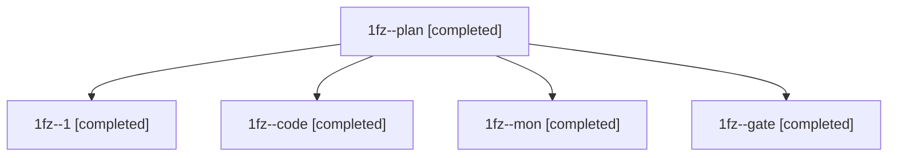

# Session: 1fz

[Agent Hoods](../README.md) / [bbugyi200](../users/bbugyi200/README.md) / [athena](../users/bbugyi200/machines/athena/README.md) / [1fz](../users/bbugyi200/machines/athena/hoods/1fz/README.md) / 1fz

Owner: `bbugyi200.athena` · Hood: `1fz` · Members: 5

## Lineage

The diagram is an optional enhancement; the ordered table below contains the same lineage in accessible text.

| Role | Agent | State | Model / provider | Timing | Commits | Prompt | Chat |
|---|---|---|---|---|---:|---|---|
| plan | 1fz--plan | completed | opus / claude | 2026-11-25T15:05:48.204457+00:00 → 2026-11-25T15:15:03.358828+00:00 | 0 | [Prompt](../agents/bbugyi200.athena.1fz--plan/prompt.md) | [Chat](../agents/bbugyi200.athena.1fz--plan/chat.md) |
| 1 | 1fz--1 | completed | muse-spark-1.3-contributor / muse | 2026-11-25T15:41:30.471930+00:00 → 2026-11-25T15:43:23.888198+00:00 | [1](../agents/bbugyi200.athena.1fz--1/README.md#commits) | [Prompt](../agents/bbugyi200.athena.1fz--1/prompt.md) | [Chat](../agents/bbugyi200.athena.1fz--1/chat.md) |
| code | 1fz--code | completed | muse-spark-1.3-contributor / muse | 2026-11-25T15:17:15.001271+00:00 → 2026-11-25T15:32:26.727625+00:00 | 0 | [Prompt](../agents/bbugyi200.athena.1fz--code/prompt.md) | [Chat](../agents/bbugyi200.athena.1fz--code/chat.md) |
| mon | 1fz--mon | completed | muse-spark-1.3-contributor / muse | 2026-11-25T15:30:46.891923+00:00 → 2026-11-25T15:41:30.931314+00:00 | 0 | — | [Chat](../agents/bbugyi200.athena.1fz--mon/chat.md) |
| gate | 1fz--gate | completed | opus / claude | 2026-11-25T15:15:22.372945+00:00 → 2026-11-25T15:16:47.715221+00:00 | 0 | — | [Chat](../agents/bbugyi200.athena.1fz--gate/chat.md) |

## Commits

| Role | Repo | Commit | Subject | Committed |
|---|---|---|---|---|
| 1 | sase | [`c4e3d68`](https://github.com/sase-org/sase/commit/c4e3d6822bf523cf40d6e9a14651aec69637c1a5) | feat(stranded): coalesce warmup toast flood with incident-keyed toasts and degraded-report skip | 2026-11-25 10:43:01 EST |
