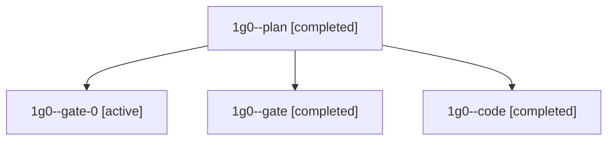

# Session: 1g0

[Agent Hoods](../README.md) / [bbugyi200](../users/bbugyi200/README.md) / [athena](../users/bbugyi200/machines/athena/README.md) / [1g0](../users/bbugyi200/machines/athena/hoods/1g0/README.md) / 1g0

Owner: `bbugyi200.athena` · Hood: `1g0` · Members: 4

## Lineage

The diagram is an optional enhancement; the ordered table below contains the same lineage in accessible text.

| Role | Agent | State | Model / provider | Timing | Commits | Prompt | Chat |
|---|---|---|---|---|---:|---|---|
| plan | 1g0--plan | completed | opus / claude | 2026-11-25T15:26:35.238169+00:00 → 2026-11-25T15:36:09.884696+00:00 | 0 | [Prompt](../agents/bbugyi200.athena.1g0--plan/prompt.md) | [Chat](../agents/bbugyi200.athena.1g0--plan/chat.md) |
| gate-0 | 1g0--gate-0 | active | grok-4.6 / grok | 2026-11-25T16:54:11.634654+00:00 | 0 | — | — |
| gate | 1g0--gate | completed | opus / claude | 2026-11-25T15:37:47.739797+00:00 → 2026-11-25T15:38:33.034553+00:00 | 0 | — | [Chat](../agents/bbugyi200.athena.1g0--gate/chat.md) |
| code | 1g0--code | completed | grok-4.6 / grok | 2026-11-25T15:38:43.709838+00:00 → 2026-11-25T16:54:17.903829+00:00 | [1](../agents/bbugyi200.athena.1g0--code/README.md#commits) | [Prompt](../agents/bbugyi200.athena.1g0--code/prompt.md) | [Chat](../agents/bbugyi200.athena.1g0--code/chat.md) |

## Commits

| Role | Repo | Commit | Subject | Committed |
|---|---|---|---|---|
| code | sase | [`b650333`](https://github.com/sase-org/sase/commit/b65033346ba7d1907a7b8a756248ea3f4a009e8b) | test(llm-provider): collect agy windows with epoch-zero reset sentinel | 2026-11-25 11:53:44 EST |
