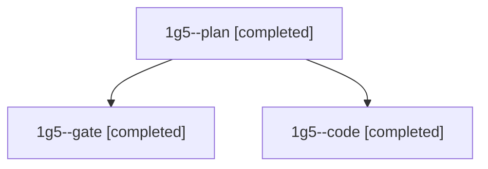

# Session: 1g5

[Agent Hoods](../README.md) / [bbugyi200](../users/bbugyi200/README.md) / [athena](../users/bbugyi200/machines/athena/README.md) / [1g5](../users/bbugyi200/machines/athena/hoods/1g5/README.md) / 1g5

Owner: `bbugyi200.athena` · Hood: `1g5` · Members: 3

## Lineage

The diagram is an optional enhancement; the ordered table below contains the same lineage in accessible text.

| Role | Agent | State | Model / provider | Timing | Commits | Prompt | Chat |
|---|---|---|---|---|---:|---|---|
| plan | 1g5--plan | completed | opus / claude | 2026-11-25T19:27:51.371520+00:00 → 2026-11-25T19:46:32.806050+00:00 | 0 | [Prompt](../agents/bbugyi200.athena.1g5--plan/prompt.md) | [Chat](../agents/bbugyi200.athena.1g5--plan/chat.md) |
| gate | 1g5--gate | completed | opus / claude | 2026-11-25T19:47:10.061675+00:00 → 2026-11-25T19:49:09.214090+00:00 | 0 | — | [Chat](../agents/bbugyi200.athena.1g5--gate/chat.md) |
| code | 1g5--code | completed | gpt-6-luna / codex | 2026-11-25T19:49:32.983851+00:00 → 2026-11-25T21:12:01.266371+00:00 | [1](../agents/bbugyi200.athena.1g5--code/README.md#commits) | [Prompt](../agents/bbugyi200.athena.1g5--code/prompt.md) | [Chat](../agents/bbugyi200.athena.1g5--code/chat.md) |

## Commits

| Role | Repo | Commit | Subject | Committed |
|---|---|---|---|---|
| code | sase | [`696e018`](https://github.com/sase-org/sase/commit/696e0180f4a0cb971502871ef64b44504efed38d) | feat(agents-sync): speed targeted publication planning | 2026-11-25 16:11:43 EST |
