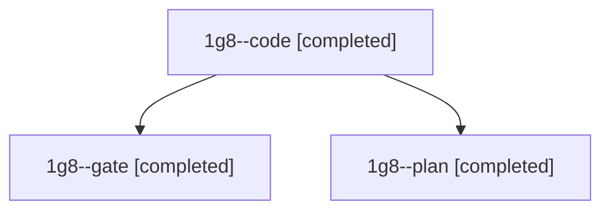

# Session: 1g8

[Agent Hoods](../README.md) / [bbugyi200](../users/bbugyi200/README.md) / [athena](../users/bbugyi200/machines/athena/README.md) / [1g8](../users/bbugyi200/machines/athena/hoods/1g8/README.md) / 1g8

Owner: `bbugyi200.athena` · Hood: `1g8` · Members: 3

## Lineage

The diagram is an optional enhancement; the ordered table below contains the same lineage in accessible text.

| Role | Agent | State | Model / provider | Timing | Commits | Prompt | Chat |
|---|---|---|---|---|---:|---|---|
| code | 1g8--code | completed | gpt-6-luna / codex | 2026-11-25T21:42:02.344685+00:00 → 2026-11-25T22:07:11.198199+00:00 | 0 | [Prompt](../agents/bbugyi200.athena.1g8--code/prompt.md) | [Chat](../agents/bbugyi200.athena.1g8--code/chat.md) |
| gate | 1g8--gate | completed | opus / claude | 2026-11-25T21:40:37.009838+00:00 → 2026-11-25T21:41:37.479503+00:00 | 0 | — | [Chat](../agents/bbugyi200.athena.1g8--gate/chat.md) |
| plan | 1g8--plan | completed | opus / claude | 2026-11-25T21:31:30.216630+00:00 → 2026-11-25T21:40:13.657868+00:00 | 0 | [Prompt](../agents/bbugyi200.athena.1g8--plan/prompt.md) | [Chat](../agents/bbugyi200.athena.1g8--plan/chat.md) |

## Neighbors

| Agent | Relation | State |
|---|---|---|
| [1g8.w0](bbugyi200.athena.1g8.w0.md) (session · 5) | descendant | completed 5 |
| [1g8.w0.w0](../agents/bbugyi200.athena.1g8.w0.w0/README.md) | descendant | waiting |
