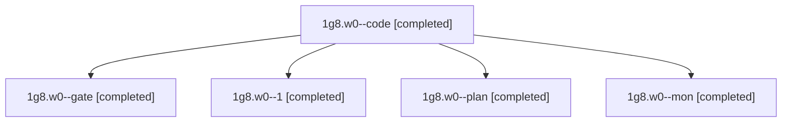

# Session: 1g8.w0

[Agent Hoods](../README.md) / [bbugyi200](../users/bbugyi200/README.md) / [athena](../users/bbugyi200/machines/athena/README.md) / [1g8](../users/bbugyi200/machines/athena/hoods/1g8/README.md) / 1g8.w0

Owner: `bbugyi200.athena` · Hood: `1g8` · Members: 5

## Lineage

The diagram is an optional enhancement; the ordered table below contains the same lineage in accessible text.

| Role | Agent | State | Model / provider | Timing | Commits | Prompt | Chat |
|---|---|---|---|---|---:|---|---|
| code | 1g8.w0--code | completed | muse-spark-1.3-contributor / muse | 2026-11-25T22:23:45.237060+00:00 → 2026-11-25T22:47:21.964860+00:00 | 0 | [Prompt](../agents/bbugyi200.athena.1g8.w0--code/prompt.md) | [Chat](../agents/bbugyi200.athena.1g8.w0--code/chat.md) |
| gate | 1g8.w0--gate | completed | opus / claude | 2026-11-25T22:22:25.495782+00:00 → 2026-11-25T22:23:20.721814+00:00 | 0 | — | [Chat](../agents/bbugyi200.athena.1g8.w0--gate/chat.md) |
| 1 | 1g8.w0--1 | completed | muse-spark-1.3-contributor / muse | 2026-11-25T23:12:40.982473+00:00 → 2026-11-25T23:13:55.190366+00:00 | 0 | [Prompt](../agents/bbugyi200.athena.1g8.w0--1/prompt.md) | [Chat](../agents/bbugyi200.athena.1g8.w0--1/chat.md) |
| plan | 1g8.w0--plan | completed | opus / claude | 2026-11-25T22:07:34.873962+00:00 → 2026-11-25T22:21:42.554830+00:00 | 0 | [Prompt](../agents/bbugyi200.athena.1g8.w0--plan/prompt.md) | [Chat](../agents/bbugyi200.athena.1g8.w0--plan/chat.md) |
| mon | 1g8.w0--mon | completed | muse-spark-1.3-contributor / muse | 2026-11-25T22:46:20.966160+00:00 → 2026-11-25T23:05:34.291111+00:00 | 0 | — | [Chat](../agents/bbugyi200.athena.1g8.w0--mon/chat.md) |

## Neighbors

| Agent | Relation | State |
|---|---|---|
| [1g8](bbugyi200.athena.1g8.md) (session · 3) | ancestor | completed 3 |
| [1g8.w0.w0](bbugyi200.athena.1g8.w0.w0.md) (session · 3) | descendant | completed 3 |
