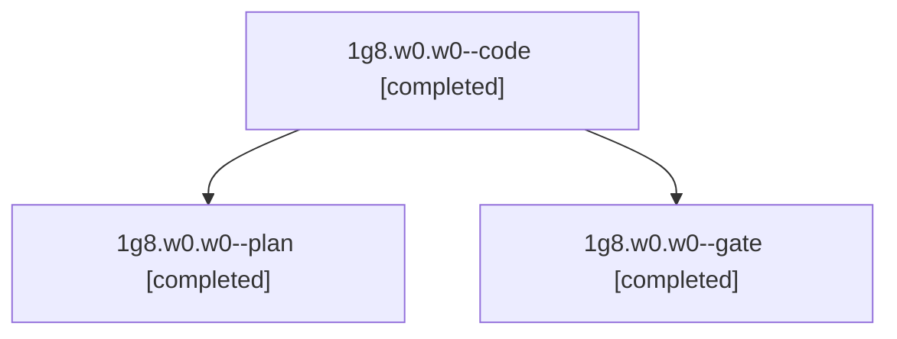

# Session: 1g8.w0.w0

[Agent Hoods](../README.md) / [bbugyi200](../users/bbugyi200/README.md) / [athena](../users/bbugyi200/machines/athena/README.md) / [1g8](../users/bbugyi200/machines/athena/hoods/1g8/README.md) / 1g8.w0.w0

Owner: `bbugyi200.athena` · Hood: `1g8` · Members: 3

## Lineage

The diagram is an optional enhancement; the ordered table below contains the same lineage in accessible text.

| Role | Agent | State | Model / provider | Timing | Commits | Prompt | Chat |
|---|---|---|---|---|---:|---|---|
| code | 1g8.w0.w0--code | completed | gpt-6-luna / codex | 2026-11-26T01:40:52.937857+00:00 → 2026-11-26T02:43:08.582293+00:00 | [1](../agents/bbugyi200.athena.1g8.w0.w0--code/README.md#commits) | [Prompt](../agents/bbugyi200.athena.1g8.w0.w0--code/prompt.md) | [Chat](../agents/bbugyi200.athena.1g8.w0.w0--code/chat.md) |
| plan | 1g8.w0.w0--plan | completed | opus / claude | 2026-11-25T23:14:22.673141+00:00 → 2026-11-25T23:21:37.695760+00:00 | 0 | [Prompt](../agents/bbugyi200.athena.1g8.w0.w0--plan/prompt.md) | [Chat](../agents/bbugyi200.athena.1g8.w0.w0--plan/chat.md) |
| gate | 1g8.w0.w0--gate | completed | opus / claude | 2026-11-26T01:39:52.174277+00:00 → 2026-11-26T01:40:27.782835+00:00 | 0 | — | [Chat](../agents/bbugyi200.athena.1g8.w0.w0--gate/chat.md) |

## Commits

| Role | Repo | Commit | Subject | Committed |
|---|---|---|---|---|
| code | sase | [`32b0d45`](https://github.com/sase-org/sase/commit/32b0d45935000eb039242363c2064ff0f8e14e31) | fix(completion): prevent CLI snapshot drift | 2026-11-25 21:42:51 EST |

## Neighbors

| Agent | Relation | State |
|---|---|---|
| [1g8.w0](bbugyi200.athena.1g8.w0.md) (session · 5) | ancestor | completed 5 |
| [1g8](bbugyi200.athena.1g8.md) (session · 3) | ancestor | completed 3 |
