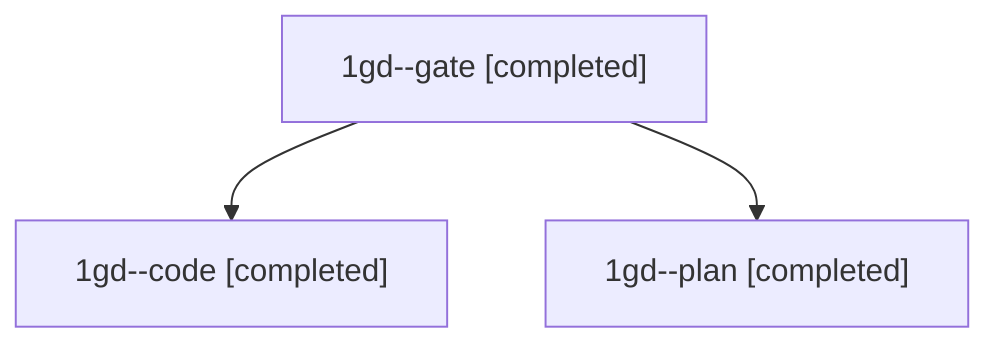

# Session: 1gd

[Agent Hoods](../README.md) / [bbugyi200](../users/bbugyi200/README.md) / [athena](../users/bbugyi200/machines/athena/README.md) / [1gd](../users/bbugyi200/machines/athena/hoods/1gd/README.md) / 1gd

Owner: `bbugyi200.athena` · Hood: `1gd` · Members: 3

## Lineage

The diagram is an optional enhancement; the ordered table below contains the same lineage in accessible text.

| Role | Agent | State | Model / provider | Timing | Commits | Prompt | Chat |
|---|---|---|---|---|---:|---|---|
| gate | 1gd--gate | completed | opus / claude | 2026-11-26T10:49:30.699794+00:00 → 2026-11-26T10:50:05.525292+00:00 | 0 | — | [Chat](../agents/bbugyi200.athena.1gd--gate/chat.md) |
| code | 1gd--code | completed | gpt-6-luna / codex | 2026-11-26T10:50:36.166912+00:00 → 2026-11-26T10:54:33.910651+00:00 | 0 | [Prompt](../agents/bbugyi200.athena.1gd--code/prompt.md) | [Chat](../agents/bbugyi200.athena.1gd--code/chat.md) |
| plan | 1gd--plan | completed | opus / claude | 2026-11-26T10:33:24.920413+00:00 → 2026-11-26T10:44:53.101688+00:00 | 0 | [Prompt](../agents/bbugyi200.athena.1gd--plan/prompt.md) | [Chat](../agents/bbugyi200.athena.1gd--plan/chat.md) |
