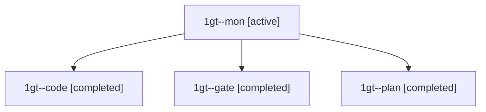

# Session: 1gt

[Agent Hoods](../README.md) / [bbugyi200](../users/bbugyi200/README.md) / [athena](../users/bbugyi200/machines/athena/README.md) / [1gt](../users/bbugyi200/machines/athena/hoods/1gt/README.md) / 1gt

Owner: `bbugyi200.athena` · Hood: `1gt` · Members: 4

## Lineage

The diagram is an optional enhancement; the ordered table below contains the same lineage in accessible text.

| Role | Agent | State | Model / provider | Timing | Commits | Prompt | Chat |
|---|---|---|---|---|---:|---|---|
| mon | 1gt--mon | active | muse-spark-1.3-contributor / muse | 2026-11-26T19:59:57.434889+00:00 | 0 | — | — |
| code | 1gt--code | completed | muse-spark-1.3-contributor / muse | 2026-11-26T19:46:19.955225+00:00 → 2026-11-26T20:09:46.307919+00:00 | 0 | [Prompt](../agents/bbugyi200.athena.1gt--code/prompt.md) | [Chat](../agents/bbugyi200.athena.1gt--code/chat.md) |
| gate | 1gt--gate | completed | opus / claude | 2026-11-26T19:42:40.871981+00:00 → 2026-11-26T19:45:55.316321+00:00 | 0 | — | [Chat](../agents/bbugyi200.athena.1gt--gate/chat.md) |
| plan | 1gt--plan | completed | opus / claude | 2026-11-26T19:26:57.206794+00:00 → 2026-11-26T19:41:51.157422+00:00 | 0 | [Prompt](../agents/bbugyi200.athena.1gt--plan/prompt.md) | [Chat](../agents/bbugyi200.athena.1gt--plan/chat.md) |

## Neighbors

| Agent | Relation | State |
|---|---|---|
| [1gt.w0](../agents/bbugyi200.athena.1gt.w0/README.md) | descendant | waiting |
