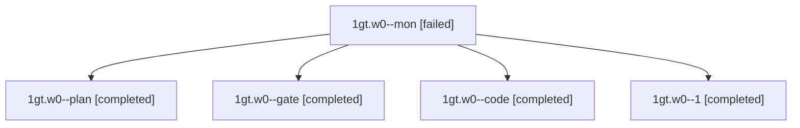

# Session: 1gt.w0

[Agent Hoods](../README.md) / [bbugyi200](../users/bbugyi200/README.md) / [athena](../users/bbugyi200/machines/athena/README.md) / [1gt](../users/bbugyi200/machines/athena/hoods/1gt/README.md) / 1gt.w0

Owner: `bbugyi200.athena` · Hood: `1gt` · Members: 5

## Lineage

The diagram is an optional enhancement; the ordered table below contains the same lineage in accessible text.

| Role | Agent | State | Model / provider | Timing | Commits | Prompt | Chat |
|---|---|---|---|---|---:|---|---|
| mon | 1gt.w0--mon | failed | muse-spark-1.3-contributor / muse | 2026-11-26T21:58:20.520654+00:00 → 2026-11-26T22:13:56.395882+00:00 | 0 | — | [Chat](../agents/bbugyi200.athena.1gt.w0--mon/chat.md) |
| plan | 1gt.w0--plan | completed | opus / claude | 2026-11-26T20:38:39.032556+00:00 → 2026-11-26T21:00:13.398537+00:00 | 0 | [Prompt](../agents/bbugyi200.athena.1gt.w0--plan/prompt.md) | [Chat](../agents/bbugyi200.athena.1gt.w0--plan/chat.md) |
| gate | 1gt.w0--gate | completed | opus / claude | 2026-11-26T21:29:00.294011+00:00 → 2026-11-26T21:33:26.606394+00:00 | 0 | — | [Chat](../agents/bbugyi200.athena.1gt.w0--gate/chat.md) |
| code | 1gt.w0--code | completed | muse-spark-1.3-contributor / muse | 2026-11-26T21:33:55.036793+00:00 → 2026-11-26T21:59:20.553333+00:00 | 0 | [Prompt](../agents/bbugyi200.athena.1gt.w0--code/prompt.md) | [Chat](../agents/bbugyi200.athena.1gt.w0--code/chat.md) |
| 1 | 1gt.w0--1 | completed | muse-spark-1.3-contributor / muse | 2026-11-26T22:13:56.041473+00:00 → 2026-11-26T22:17:24.532845+00:00 | [1](../agents/bbugyi200.athena.1gt.w0--1/README.md#commits) | [Prompt](../agents/bbugyi200.athena.1gt.w0--1/prompt.md) | [Chat](../agents/bbugyi200.athena.1gt.w0--1/chat.md) |

## Commits

| Role | Repo | Commit | Subject | Committed |
|---|---|---|---|---|
| 1 | sase | [`e93ea1a`](https://github.com/sase-org/sase/commit/e93ea1a0b9e54ea4712d0b4c0266b0445c73ce26) | fix(tests): stabilize single-owner bead test and real startup isolation | 2026-11-26 17:17:08 EST |

## Neighbors

| Agent | Relation | State |
|---|---|---|
| [1gt](bbugyi200.athena.1gt.md) (session · 5) | ancestor | completed 5 |
