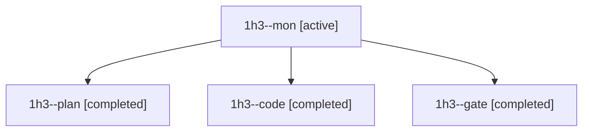

# Session: 1h3

[Agent Hoods](../README.md) / [bbugyi200](../users/bbugyi200/README.md) / [athena](../users/bbugyi200/machines/athena/README.md) / [1h3](../users/bbugyi200/machines/athena/hoods/1h3/README.md) / 1h3

Owner: `bbugyi200.athena` · Hood: `1h3` · Members: 4

## Lineage

The diagram is an optional enhancement; the ordered table below contains the same lineage in accessible text.

| Role | Agent | State | Model / provider | Timing | Commits | Prompt | Chat |
|---|---|---|---|---|---:|---|---|
| mon | 1h3--mon | active | gpt-6-luna / codex | 2026-11-27T15:17:01.825089+00:00 | 0 | — | — |
| plan | 1h3--plan | completed | opus / claude | 2026-11-27T14:40:03.697544+00:00 → 2026-11-27T14:45:50.645837+00:00 | 0 | [Prompt](../agents/bbugyi200.athena.1h3--plan/prompt.md) | [Chat](../agents/bbugyi200.athena.1h3--plan/chat.md) |
| code | 1h3--code | completed | gpt-6-luna / codex | 2026-11-27T14:50:33.784412+00:00 → 2026-11-27T15:18:45.529976+00:00 | [1](../agents/bbugyi200.athena.1h3--code/README.md#commits) | [Prompt](../agents/bbugyi200.athena.1h3--code/prompt.md) | [Chat](../agents/bbugyi200.athena.1h3--code/chat.md) |
| gate | 1h3--gate | completed | opus / claude | 2026-11-27T14:49:07.243782+00:00 → 2026-11-27T14:50:09.807719+00:00 | 0 | — | [Chat](../agents/bbugyi200.athena.1h3--gate/chat.md) |

## Commits

| Role | Repo | Commit | Subject | Committed |
|---|---|---|---|---|
| code | sase | [`aeecbc3`](https://github.com/sase-org/sase/commit/aeecbc33918930c4f85860dda179e77c65d31bed) | fix(agents): stop clan l jumps at member sessions | 2026-11-27 10:18:23 EST |
