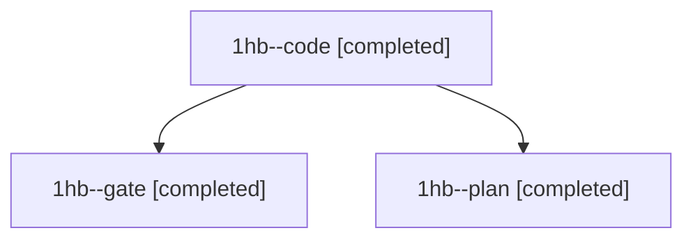

# Session: 1hb

[Agent Hoods](../README.md) / [bbugyi200](../users/bbugyi200/README.md) / [athena](../users/bbugyi200/machines/athena/README.md) / [1hb](../users/bbugyi200/machines/athena/hoods/1hb/README.md) / 1hb

Owner: `bbugyi200.athena` · Hood: `1hb` · Members: 3

## Lineage



The diagram is an optional enhancement; the ordered table below contains the same lineage in accessible text.

| Role | Agent | State | Model / provider | Timing | Commits | Prompt | Chat |
|---|---|---|---|---|---:|---|---|
| <a id="member-code"></a>code | 1hb--code | completed | grok-4.6 / grok | 2026-11-27T17:53:48.088043+00:00 → 2026-11-27T19:33:35.827057+00:00 | [1](../agents/bbugyi200.athena.1hb--code/README.md#commits) | [Prompt](../agents/bbugyi200.athena.1hb--code/prompt.md) | [Chat](../agents/bbugyi200.athena.1hb--code/chat.md) |
| <a id="member-gate"></a>gate | 1hb--gate | completed | opus / claude | 2026-11-27T17:52:28.041855+00:00 → 2026-11-27T17:53:23.374422+00:00 | 0 | — | [Chat](../agents/bbugyi200.athena.1hb--gate/chat.md) |
| <a id="member-plan"></a>plan | 1hb--plan | completed | opus / claude | 2026-11-27T17:41:03.501754+00:00 → 2026-11-27T17:51:23.973705+00:00 | 0 | [Prompt](../agents/bbugyi200.athena.1hb--plan/prompt.md) | [Chat](../agents/bbugyi200.athena.1hb--plan/chat.md) |

## Commits

| Role | Repo | Commit | Subject | Committed |
|---|---|---|---|---|
| code | sase | [`324beb2`](https://github.com/sase-org/sase/commit/324beb2ce8985f995b87c1311b1287e80518f516) | fix(scheduler): honor artifact-link job work budgets under load | 2026-11-27 14:33:19 EST |

## Variables

| Role | Variable | Value |
|---|---|---|
| code | `follow_ups` | \[sase-1vo, sase-1vp, sase-1vq, sase-1vr\] |
| code | `summary` | Implemented keep-timeout artifact-link job budgets; axe timeouts stay 5m. |

#### follow_ups

**Role:** `code`

```yaml
- sase-1vo
- sase-1vp
- sase-1vq
- sase-1vr
```
