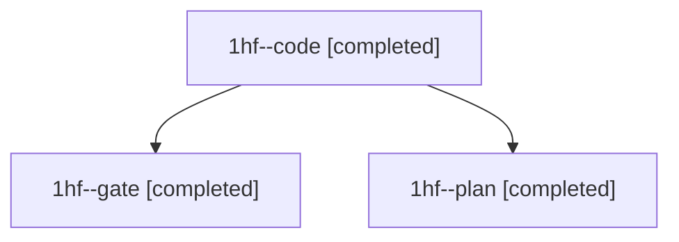

# Session: 1hf

[Agent Hoods](../README.md) / [bbugyi200](../users/bbugyi200/README.md) / [athena](../users/bbugyi200/machines/athena/README.md) / [1hf](../users/bbugyi200/machines/athena/hoods/1hf/README.md) / 1hf

Owner: `bbugyi200.athena` · Hood: `1hf` · Members: 3

## Lineage

The diagram is an optional enhancement; the ordered table below contains the same lineage in accessible text.

| Role | Agent | State | Model / provider | Timing | Commits | Prompt | Chat |
|---|---|---|---|---|---:|---|---|
| code | 1hf--code | completed | grok-4.6 / grok | 2026-11-27T20:01:28.874126+00:00 → 2026-11-27T20:43:28.351773+00:00 | [1](../agents/bbugyi200.athena.1hf--code/README.md#commits) | [Prompt](../agents/bbugyi200.athena.1hf--code/prompt.md) | [Chat](../agents/bbugyi200.athena.1hf--code/chat.md) |
| gate | 1hf--gate | completed | opus / claude | 2026-11-27T20:00:07.497881+00:00 → 2026-11-27T20:00:48.825986+00:00 | 0 | — | [Chat](../agents/bbugyi200.athena.1hf--gate/chat.md) |
| plan | 1hf--plan | completed | opus / claude | 2026-11-27T19:43:16.622562+00:00 → 2026-11-27T19:55:04.020476+00:00 | 0 | [Prompt](../agents/bbugyi200.athena.1hf--plan/prompt.md) | [Chat](../agents/bbugyi200.athena.1hf--plan/chat.md) |

## Commits

| Role | Repo | Commit | Subject | Committed |
|---|---|---|---|---|
| code | sase | [`8c77e6f`](https://github.com/sase-org/sase/commit/8c77e6fa642c63ade5c5d794dc5900c20103d0b5) | fix(ace): hold ,x relaunches until kill/dismiss cleanup settles | 2026-11-27 15:43:08 EST |
