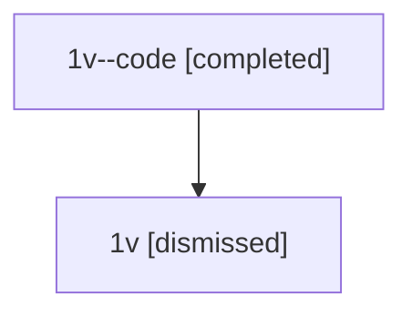

# Session: 1v

[Agent Hoods](../README.md) / [bbugyi200](../users/bbugyi200/README.md) / [athena](../users/bbugyi200/machines/athena/README.md) / [1v](../users/bbugyi200/machines/athena/hoods/1v/README.md) / 1v

Owner: `bbugyi200.athena` · Hood: `1v` · Members: 2

## Lineage

The diagram is an optional enhancement; the ordered table below contains the same lineage in accessible text.

| Role | Agent | State | Model / provider | Timing | Commits | Prompt | Chat |
|---|---|---|---|---|---:|---|---|
| code | 1v--code | completed | gpt-5.5 / codex | 2026-07-08T07:01:46.897958+00:00 | [1](../agents/bbugyi200.athena.1v--code/README.md#commits) | — | [Chat](../agents/bbugyi200.athena.1v--code/chat.md) |
| root | 1v | dismissed | gpt-5.5 / codex | 2026-07-08T02:57:12.910477 → 2026-07-08T03:09:22.327757 | [1](../agents/bbugyi200.athena.1v/README.md#commits) | [Prompt](../agents/bbugyi200.athena.1v/prompt.md) | [Chat](../agents/bbugyi200.athena.1v/chat.md) |

## Commits

| Role | Repo | Commit | Subject | Committed |
|---|---|---|---|---|
| — | — | `9b07496` | chore: Add SDD prompt and plan for bob\_dataview\_reads | 2026-06-03 15:55:48 EDT |
| — | — | `66305ab` | chore: create bob dataview reads beads | 2026-06-03 15:59:42 EDT |
| root | — | `b0d8eae` | chore: Add SDD prompt and plan for logs\_tab\_jump\_hints | 2026-07-08 03:01:45 EDT |
| code | — | `5e9300e` | test: cover log jump hints in admin center | 2026-07-08 03:09:06 EDT |
