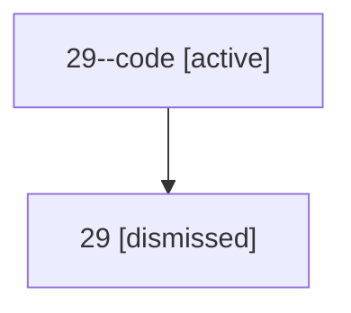

# Session: 29

[Agent Hoods](../README.md) / [bbugyi200](../users/bbugyi200/README.md) / [athena](../users/bbugyi200/machines/athena/README.md) / [29](../users/bbugyi200/machines/athena/hoods/29/README.md) / 29

Owner: `bbugyi200.athena` · Hood: `29` · Members: 2

## Lineage

The diagram is an optional enhancement; the ordered table below contains the same lineage in accessible text.

| Role | Agent | State | Model / provider | Timing | Commits | Prompt | Chat |
|---|---|---|---|---|---:|---|---|
| code | 29--code | active | gpt-5.5 / codex | 2026-07-08T17:50:27.483599+00:00 | 0 | — | — |
| root | 29 | dismissed | opus / claude | 2026-07-08T13:45:40.927064 → 2026-07-08T13:50:31.229520 | 0 | [Prompt](../agents/bbugyi200.athena.29/prompt.md) | [Chat](../agents/bbugyi200.athena.29/chat.md) |

## Commits

| Role | Repo | Commit | Subject | Committed |
|---|---|---|---|---|
| — | — | `84f289d` | chore: Add SDD prompt and plan for project\_aliases | 2026-06-04 10:31:57 EDT |
| — | — | `1a95ca1` | chore: create project aliases epic beads | 2026-06-04 10:37:13 EDT |

## Neighbors

| Agent | Relation | State |
|---|---|---|
| [29.f1](../agents/bbugyi200.athena.29.f1/README.md) | descendant | dismissed |
