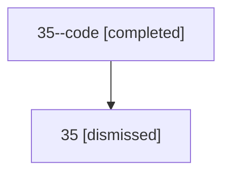

# Session: 35

[Agent Hoods](../README.md) / [bbugyi200](../users/bbugyi200/README.md) / [athena](../users/bbugyi200/machines/athena/README.md) / [35](../users/bbugyi200/machines/athena/hoods/35/README.md) / 35

Owner: `bbugyi200.athena` · Hood: `35` · Members: 2

## Lineage

The diagram is an optional enhancement; the ordered table below contains the same lineage in accessible text.

| Role | Agent | State | Model / provider | Timing | Commits | Prompt | Chat |
|---|---|---|---|---|---:|---|---|
| code | 35--code | completed | gpt-5.5 / codex | 2026-07-09T01:53:42.029856+00:00 | [1](../agents/bbugyi200.athena.35--code/README.md#commits) | — | [Chat](../agents/bbugyi200.athena.35--code/chat.md) |
| root | 35 | dismissed | gpt-5.5 / codex | 2026-07-08T21:49:54.421499 → 2026-07-08T22:02:33.701290 | 0 | [Prompt](../agents/bbugyi200.athena.35/prompt.md) | [Chat](../agents/bbugyi200.athena.35/chat.md) |

## Commits

| Role | Repo | Commit | Subject | Committed |
|---|---|---|---|---|
| — | — | `59aa4b3` | chore: Add SDD prompt and plan for home\_provider\_shim\_refs | 2026-06-06 10:02:21 EDT |
| — | — | `10ec1ef` | fix: use home provider shim refs for home roots | 2026-06-06 10:16:43 EDT |
| code | — | `992722f` | fix(ace): distinguish prompt stash badge color | 2026-07-08 22:02:16 EDT |
