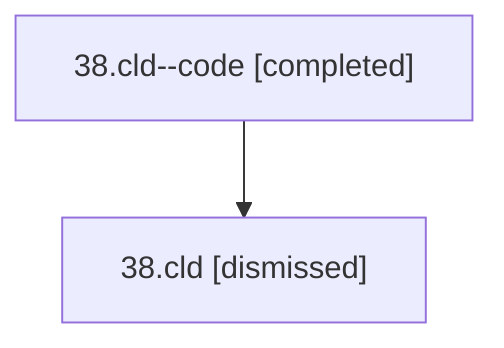

# Session: 38.cld

[Agent Hoods](../README.md) / [bbugyi200](../users/bbugyi200/README.md) / [athena](../users/bbugyi200/machines/athena/README.md) / [38](../users/bbugyi200/machines/athena/hoods/38/README.md) / 38.cld

Owner: `bbugyi200.athena` · Hood: `38` · Members: 2

## Lineage

The diagram is an optional enhancement; the ordered table below contains the same lineage in accessible text.

| Role | Agent | State | Model / provider | Timing | Commits | Prompt | Chat |
|---|---|---|---|---|---:|---|---|
| code | 38.cld--code | completed | gpt-5.5 / codex | 2026-07-09T02:43:05.274349+00:00 | [1](../agents/bbugyi200.athena.38.cld--code/README.md#commits) | — | [Chat](../agents/bbugyi200.athena.38.cld--code/chat.md) |
| root | 38.cld | dismissed | opus / claude | 2026-07-08T22:25:28.377914 → 2026-07-08T22:56:15.680649 | 0 | [Prompt](../agents/bbugyi200.athena.38.cld/prompt.md) | [Chat](../agents/bbugyi200.athena.38.cld/chat.md) |

## Commits

| Role | Repo | Commit | Subject | Committed |
|---|---|---|---|---|
| code | — | `b38c1b2` | fix: avoid stale agents tab diff fallback | 2026-07-08 22:55:57 EDT |

## Neighbors

| Agent | Relation | State |
|---|---|---|
| [38.cdx](../agents/bbugyi200.athena.38.cdx/README.md) | 38 hood | dismissed |
