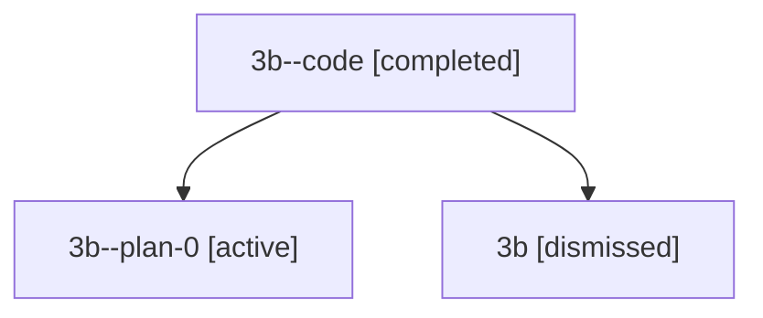

# Session: 3b

[Agent Hoods](../README.md) / [bbugyi200](../users/bbugyi200/README.md) / [athena](../users/bbugyi200/machines/athena/README.md) / [3b](../users/bbugyi200/machines/athena/hoods/3b/README.md) / 3b

Owner: `bbugyi200.athena` · Hood: `3b` · Members: 3

## Lineage

The diagram is an optional enhancement; the ordered table below contains the same lineage in accessible text.

| Role | Agent | State | Model / provider | Timing | Commits | Prompt | Chat |
|---|---|---|---|---|---:|---|---|
| code | 3b--code | completed | gpt-5.5 / codex | 2026-07-09T05:02:00.609101+00:00 | [1](../agents/bbugyi200.athena.3b--code/README.md#commits) | — | [Chat](../agents/bbugyi200.athena.3b--code/chat.md) |
| plan-0 | 3b--plan-0 | active | opus / claude | 2026-07-09T04:40:27.447792+00:00 | 0 | — | [Chat](../agents/bbugyi200.athena.3b--plan-0/chat.md) |
| root | 3b | dismissed | opus / claude | 2026-07-09T00:24:46.525202 → 2026-07-09T01:08:10.307150 | 0 | [Prompt](../agents/bbugyi200.athena.3b/prompt.md) | [Chat](../agents/bbugyi200.athena.3b/chat.md) |

## Commits

| Role | Repo | Commit | Subject | Committed |
|---|---|---|---|---|
| — | — | `e76d34c` | chore: Add SDD prompt and plan for prompt\_completion\_project\_root | 2026-06-06 14:17:25 EDT |
| — | — | `f088603` | feat: resolve prompt path completions from project refs | 2026-06-06 14:33:54 EDT |
| code | — | `13b2768` | ci: clone SDD companion in lint job | 2026-07-09 01:07:50 EDT |

## Neighbors

| Agent | Relation | State |
|---|---|---|
| [3b.f1](../agents/bbugyi200.athena.3b.f1/README.md) | descendant | active |
